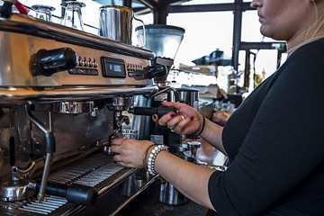

# Café Photo Sorter

Copies a folder of café photos into **Food & Drinks**, **People** and **Interior** albums by looking at the image content (never the filename), runs fully offline after a one-time model download, and never modifies the originals.

## Quick start

Python 3.11+, CPU only.

```bash
git clone https://github.com/1brah1m0f/sort_photos_task.git
cd sort_photos_task/sort-photos
python3.11 -m venv .venv && source .venv/bin/activate

python -m pip install torch==2.15.0 torchvision==0.29.2 --index-url https://download.pytorch.org/whl/cpu
python -m pip install -e .

photo-sorter download-model      # one-time, ~340 MB; the only step that needs internet
photo-sorter sort --input ~/my_cafe_photos --output ~/cafe_albums
```

You get `Food & Drinks/`, `People/`, `Interior/` and a `predictions.csv` with the probabilities for every photo. JPEG, PNG, WebP, TIFF and iPhone HEIC are supported.

## Results

45 new café photos from 35 venue/photographer groups that were never used for training:

| | First model | Retrained model |
|---|---|---|
| **Overall** | 25 / 45 (55.6%) | **43 / 45 (95.6%)** |
| Food & Drinks recall | 10 / 15 | 15 / 15 |
| People recall | 0 / 15 | 13 / 15 |
| Interior recall | 15 / 15 | 15 / 15 |

Both errors are People photos where something else fills most of the frame: the barista below and a crowded café terrace (predicted Interior). 45 photos is a small sample, so read 95.6% as "roughly 85–99%", not as an exact figure.

## Difficult example



Labelled **People**, predicted Food & Drinks **0.41** · People **0.37** · Interior **0.22**.

The barista's face is out of frame. Her arm and shirt take up a third of the picture, and the espresso machine, portafilter and cups fill the rest. Under the "main subject" rule this is someone making coffee, so People, but most of the pixels are coffee equipment, which the model has learned to link with drinks. The near three-way split shows the model is unsure. Adding `--min-confidence 0.5 --unsure` would send this photo to an `Unsure/` album for review.

Full technical details → [docs/DETAILS.md](docs/DETAILS.md)
