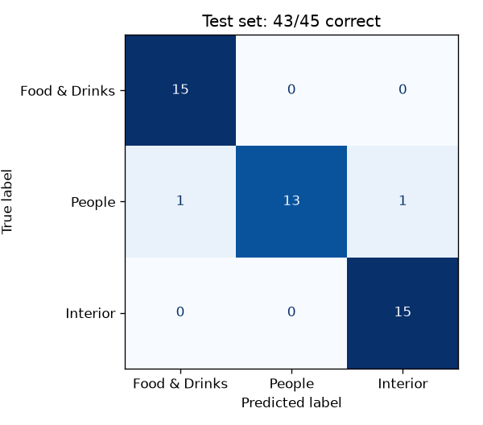
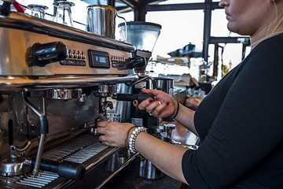

# Café Photo Sorter: technical details

The one-page overview and Quick start are in the [root README](../README.md). This page covers how the
model works, every command and option, training on your own photos, and the full evaluation.

**Contents:** [How it works](#how-it-works) · [Install](#install) · [Commands](#commands) ·
[Train on your own photos](#train-on-your-own-photos) · [Results](#results) ·
[A difficult example](#a-difficult-example) · [Tests](#tests) · [Project structure](#project-structure) ·
[Limitations](#limitations-and-possible-improvements)

## How it works

```
photo ──► EXIF-upright RGB ──► CLIP ViT-B/32 image encoder (frozen) ──► 512-d embedding ──► logistic regression ──► album
```

1. **Frozen feature extractor.** The image tower of OpenAI's open-source CLIP ViT-B/32 (MIT license) turns each
   photo into an L2-normalised 512-number embedding. It is never fine-tuned; the text tower is not even loaded.
2. **Linear classifier.** A scikit-learn `LogisticRegression` maps the embedding to three probabilities.
   With ~300 training photos, a linear model on frozen features (3 × 513 parameters) is the right size:
   CLIP already separates "a plate of food", "a person" and "a room", and the classifier only has to find
   those directions. Fine-tuning the whole network would overfit.
3. **Only pixels.** Filenames, folder names and EXIF text fields are never used for prediction. The EXIF
   *orientation* tag is applied so rotated phone photos are seen upright. Folder names are used only as
   training/evaluation labels (`test_prediction_ignores_filename` checks this).

### Labels: the main-subject rule and the training audit

Each photo belongs to the album of its **main subject**. The first training set took its Interior photos from
Places365 *coffee_shop*, which labels the **scene** where a photo was taken, not its subject. An audit of all
50 of them found 23 that were really portraits, groups at tables, or coffee close-ups. They were relabelled
(13 → People, 10 → Food & Drinks), and the ambiguous cases, such as storefront exteriors kept as Interior, are
listed with filenames in [LABEL_AUDIT.md](../sort-photos/data/LABEL_AUDIT.md). The same audit was applied to the
benchmark test split. 171 licensed café photos from Wikimedia Commons were then added, with labels assigned by
main subject before any prediction.

| Training photos | Food & Drinks | People | Interior |
|---|---|---|---|
| First model | 50 | 50 | 50 |
| Retrained: audited original images | 60 | 63 | 27 |
| Retrained: café photos (new) | 56 | 46 | 69 |
| **Retrained total** (`data/train`) | **116** | **109** | **96** |

### Model selection with venue/photographer groups

Photos from the same café, or by the same photographer, look alike. If they land on both sides of a
cross-validation split, the score is optimistic. `train` therefore reads a **group** for every training
photo from `data/manifest.csv` and uses `StratifiedGroupKFold`, so a group is never in the training and
validation part of the same fold.

- **Café photos:** the group is a venue/photographer cluster. Photos that share a photographer or a
  venue-specific Commons category end up in the same group, giving 88 groups for the 171 café photos.
- **Older images:** the group is the Commons category for the old Wikimedia drink photos, and each COCO,
  Places365 and Food-101 image is its own group, since those are independent photos from unknown places.

The search covers C ∈ {0.01, 0.1, 1, 10, 100, 1000} × class_weight ∈ {none, balanced} and is scored by
**balanced accuracy** (mean per-class recall), so a collapsed class cannot hide behind the others.
**Selected for the shipped model: C = 1, class_weight = balanced, 5-fold grouped CV balanced accuracy
0.921 ± 0.031 over 233 groups.** The first model used C = 100, chosen by ordinary (ungrouped) CV accuracy.

## Install

Python 3.11 or newer. CPU-only, two steps (the first gets CPU builds of PyTorch, the second everything else):

```bash
cd sort-photos
python3.11 -m venv .venv && source .venv/bin/activate
python -m pip install torch==2.15.0 torchvision==0.29.2 --index-url https://download.pytorch.org/whl/cpu
python -m pip install -e ".[dev]"        # [dev] adds pytest; plain "-e ." is enough to sort
photo-sorter download-model              # one-time, ~340 MB, SHA256-verified, into sort-photos/models/backbone/
```

Step 2 keeps the `+cpu` torch from step 1 (`torch==2.15.0` is satisfied by `2.15.0+cpu`) and installs the
pinned `pillow-heif` for HEIC photos. On a CUDA machine, skip step 1 or use the matching PyTorch CUDA index; a
GPU is used automatically (`--device cpu` forces the CPU). CI runs exactly these commands
([`.github/workflows/test.yml`](../.github/workflows/test.yml)).

## Commands

`photo-sorter` is installed by step 2; `python -m cafe_sorter` is the same CLI. Run `photo-sorter <command> --help`
for every option.

| Command | What it does |
|---|---|
| `photo-sorter download-model` | Downloads the CLIP weights once. **The only command that uses the network.** |
| `photo-sorter sort --input DIR --output DIR` | Copies photos into the albums (details below). |
| `photo-sorter evaluate --data DIR --report-dir DIR` | Scores a labelled folder and writes `evaluation.md/.json` + `confusion_matrix.png`. |
| `photo-sorter train --data data/train --out models/` | Retrains the classifier with venue-grouped CV. |
| `photo-sorter check-duplicates --data DIR --against DIR …` | Finds exact or near-duplicate images between folders. |

Common options: `--model-dir` (default: the shipped `sort-photos/models/`; `models/baseline` is the first model),
`--batch-size` (positive integer, default 32), `--device`.

**Works from any directory.** Default model, backbone, data and report paths are absolute paths inside
`sort-photos/`, resolved from the installed package, so `photo-sorter sort` can be run from anywhere. Paths
you pass on the command line (`--input`, `--data`, `--report-dir`, …) are relative to the current directory as
usual; the evaluation commands below assume you are in `sort-photos/`.

### `sort`

```bash
photo-sorter sort --input ~/cafe_photos --output ~/cafe_albums
photo-sorter sort --input ~/cafe_photos --output ~/cafe_albums --recursive --min-confidence 0.5 --unsure
photo-sorter sort --input ~/more_photos --output ~/cafe_albums --append
```

- **Formats:** `.jpg .jpeg .png .webp .bmp .tif .tiff .heic .heif`, any letter case; EXIF orientation is
  applied. HEIC/HEIF needs `pillow-heif` (pinned in `requirements.txt`); without it, a warning is shown and HEIC
  files are skipped with that reason.
- **Copies only.** `shutil.copy2` (metadata kept) into `Food & Drinks/`, `People/` or `Interior/`. Originals are
  never moved, renamed or modified.
- **`predictions.csv`:** `original_path, album, predicted_album, confidence, low_confidence, copied_to,
  p_food_drinks, p_people, p_interior`. `album` is where the copy went; `predicted_album` is the best class.
- **`--min-confidence P`:** photos whose best probability is below `P` are flagged in the CSV and listed in
  the console (confidences shown with 3 decimals, truncated, so 0.4996 shows as 0.499, never as 0.500).
  They are still copied to their best album.
- **`--unsure`** (needs `--min-confidence > 0`): flagged photos go to an `Unsure/` album instead; the CSV says
  `album=Unsure` and keeps `predicted_album` and all probabilities.
- **Re-runs.** If an album folder already holds files or `predictions.csv` exists, `sort` stops with exit 2
  before touching anything. With **`--append`**, existing files are kept, new copies get the usual `_1`, `_2`
  names on clashes, and new rows are added after the old ones in `predictions.csv` (one row per copy across
  all runs). Empty album folders do not count as a previous run.
- **`--recursive`:** include sub-folders. Photos are classified in batches with a progress bar.
- **Bad files:** corrupt or non-image files are skipped with a warning and listed in the summary.

**Safety of the output folder**
- The output may not be the input folder, be inside it, or contain it.
- Album folders (including `Unsure/`) and `predictions.csv` are checked before anything is written; symlinks
  there, live or dangling, are rejected.
- Each destination is reserved with an exclusive create, so existing files and links count as name clashes and
  are never written through.
- A failed copy (source vanished, disk full, I/O error) deletes its empty or partial destination, is listed
  with the original error, and sorting continues.
- `predictions.csv` (old rows plus new ones with `--append`) is written to a temporary file and atomically
  renamed into place.

**Exit status**
- `0`: success, also when some files were skipped or some copies failed but at least one succeeded.
- `1`: no supported images in `--input` ("No images found in …", nothing created), or copies were attempted
  and every one failed (the count is printed; no incomplete files are left).
- `2`: invalid arguments (e.g. `--batch-size 0`, `--unsure` without `--min-confidence`), unsafe paths, an
  output folder from a previous run without `--append`, or a missing model/backbone.

### Offline behaviour

`download-model` stores the checkpoint at `sort-photos/models/backbone/ViT-B-32.pt`. Every other command loads it
only from there, never downloads anything, sets `HF_HUB_OFFLINE=1` and `TRANSFORMERS_OFFLINE=1`, and fails
with a clear message if the file is missing. This was verified by running `train`, `evaluate` and `sort` with
the network removed at the OS level:

```bash
HF_HUB_OFFLINE=1 TRANSFORMERS_OFFLINE=1 unshare -rn photo-sorter sort --input ~/cafe_photos --output ~/cafe_albums
```

## Train on your own photos

Put labelled photos in one folder per class. You can nest photos inside a class folder. The class
is the top-level folder under `--data`.

```
my_cafe/
├── train/
│   ├── food_drinks/
│   │   ├── latte.jpg
│   │   └── 2024-05/latte.jpg      # same file name as above, in a sub-folder
│   ├── people/
│   │   ├── barista_anna.jpg
│   │   └── barista_mina.jpg
│   └── interior/
│       ├── window_seats.jpg
│       └── counter.jpg
└── manifest.csv                    # optional: CV groups (picked up automatically from <data>/../manifest.csv)
```

The manifest uses the columns `class`, `filename` and `group`. Use the path inside the class folder
for `filename`. A bare file name also works when it is unique within its class. Use the venue, shoot
or photographer as the group so related photos stay together in cross-validation.

```csv
class,filename,group
food_drinks,latte.jpg,cafe-rosa
food_drinks,2024-05/latte.jpg,cafe-milano
people,barista_anna.jpg,cafe-rosa
people,barista_mina.jpg,cafe-milano
interior,window_seats.jpg,cafe-rosa
interior,counter.jpg,cafe-milano
```

Run the six-photo example from `sort-photos/` with `--folds 2`. Each of its two groups has one photo
from every class. The default five-fold run requires at least five readable photos per class and,
when using a manifest, at least five distinct groups overall.

```bash
photo-sorter train --data my_cafe/train --out models/my_cafe --folds 2
photo-sorter sort --input ~/new_photos --output ~/albums --model-dir models/my_cafe
```

Add `--no-groups` to the training command to run ordinary stratified cross-validation without a
manifest. When you use a manifest, training stops before writing the model if a photo has no group,
a bare filename is ambiguous, or the same photo is assigned to conflicting groups.

To add your photos to the shipped dataset, copy them into `sort-photos/data/train/<class>/` and add matching
`class,filename,group` rows to `sort-photos/data/manifest.csv`.

## Results

All paths in this section are relative to `sort-photos/`.

### Three evaluation sets, and why they differ

| Set | Photos | Role |
|---|---|---|
| **`data/holdout_fresh`** | 45 (15 per class) | **The main result.** Café photos from 35 venue/photographer groups not used for training or model selection; labels frozen before any prediction. |
| `data/holdout_cafe` | 45 (15 per class) | **Diagnostic** set (see below). |
| `data/test` | 45 | **Historical benchmark** from the original dataset (see below). |

### Fresh café holdout: 25 / 45 → **43 / 45**

Both models, same 45 photos, run offline:

```bash
photo-sorter evaluate --data data/holdout_fresh --report-dir reports/holdout_fresh
photo-sorter evaluate --data data/holdout_fresh --report-dir reports/holdout_fresh/baseline --model-dir models/baseline
```

| | First model (`models/baseline`) | Retrained (`models/`, default) |
|---|---|---|
| **Correct** | 25 / 45 (55.6%) | **43 / 45 (95.6%)** |
| Food & Drinks: precision / recall | 1.000 / 0.667 (10 / 15) | 0.938 / **1.000 (15 / 15)** |
| **People: precision / recall** | 0.000 / **0.000 (0 / 15)** | 1.000 / **0.867 (13 / 15)** |
| Interior: precision / recall | 0.429 / 1.000 (15 / 15) | 0.938 / 1.000 (15 / 15) |
| Single-subject / mixed-subject photos | 23 / 39, 2 / 6 | 39 / 39, 4 / 6 |

Confusion matrices (rows = true album; columns = predicted Food & Drinks, People, Interior):

| First model | Retrained |
|---|---|
| Food & Drinks: 10, 0, 5 | Food & Drinks: **15**, 0, 0 |
| People: 0, **0**, 15 | People: 1, **13**, 1 |
| Interior: 0, 0, 15 | Interior: 0, 0, **15** |



Full reports: [retrained](../sort-photos/reports/holdout_fresh/evaluation.md) · [first model](../sort-photos/reports/holdout_fresh/baseline/evaluation.md).

**What changed.**
- The first model sent all 15 café People photos to Interior. Interior was its default answer for anything
  taken inside a café, which is why its Interior recall was perfect but its precision only 0.43.
- The retrained model fixes People (13 / 15) and Food & Drinks (15 / 15) without losing any Interior photos.
- Both remaining errors are mixed-subject People photos (see [below](#a-difficult-example)).

**About the set.**
- 45 Wikimedia Commons café photos under CC0, public-domain, CC BY or CC BY-SA terms, 15 per class, 6 of them
  mixed-subject.
- The fresh holdout has **35 venue/photographer groups**. The manifests show zero overlap with training
  in recorded groups, named venues and listed photographers. The fresh and diagnostic sets also have
  distinct listed photographers.
- A venue is named for 6 of the 45 photos, including shots from Caffè Giardino, Café Guarany and
  Konditorei Buchwald. For the other 39, the recorded groups rely on photographers and Commons categories.
- `check-duplicates` found 0 exact, perceptual-hash or near-duplicate (CLIP cosine ≥ 0.95) matches against
  train, test and `holdout_cafe`. The closest pair (cosine 0.938) is two different latte cups.
- Labels were frozen at 2026-11-15T13:35:09Z, before any prediction. Source, author, license and label reason
  for every photo are in [`data/holdout_fresh/manifest.csv`](../sort-photos/data/holdout_fresh/manifest.csv).

**How much to trust it.** 45 photos is a small sample: each photo is worth 2.2 percentage points, and
43 / 45 is statistically consistent with a true accuracy anywhere from roughly 85% to 99%. The People result
rests on 15 photos. What the set does show clearly is the size of the change. The first model got *no*
café People photo right on this holdout, and the retrained one gets most of them.
These are public Commons photos, often well composed. A café owner's phone photos of one place may score
differently, and the best next test is a reviewer's own labelled photos ([commands](#evaluate-your-own-labelled-photos)).

### Diagnostic set (`holdout_cafe`): 26 / 45 → 43 / 45

- An earlier café holdout, inspected while diagnosing the first model, so it is no longer a clean test.
  Exact-file and listed-photographer checks found zero overlap with training.
- First model 26 / 45 (57.8%), retrained 43 / 45 (95.6%). Recall for Food & Drinks / People / Interior:
  0.667 / 0.067 / 1.000 → 0.933 / 0.933 / 1.000, consistent with the fresh holdout.
- Reports: [retrained](../sort-photos/reports/holdout_cafe/evaluation.md) · [first model](../sort-photos/reports/holdout_cafe/baseline/evaluation.md).

### Historical benchmark (`data/test`)

| Labels | First model | Retrained |
|---|---|---|
| Original source labels | 45 / 45 | 40 / 45 |
| **Audited by main subject** (current files) | 41 / 45 | **44 / 45** |

- **Why it is easy:** every People photo comes from COCO and every Interior photo from Places365
  *coffee_shop*, the same sources as the first model's training data, so it could score well by recognising
  the source dataset.
- **Why there are two rows:** with the original scene labels the retrained model calls 4 "Interior" photos
  People or Food & Drinks. An audit of all 14 test Interior photos found that exactly those 4 show people or a
  latte as the main subject (the first model had put them in Interior at 0.98–0.99). The audit happened *after*
  the retrained predictions were seen, so both rows are reported ([LABEL_AUDIT.md](../sort-photos/data/LABEL_AUDIT.md)).
- **Hardest correct photo:** `data/test/people/4eda754771ad4d60ba25939c7b1efa9f.jpg`, a vintage black-and-white
  snapshot of two people on an armchair in a furnished living room. First model People 0.69 / Interior 0.30
  (the one photo flagged by `--min-confidence 0.7` in an earlier demo run); retrained People 0.86 / Interior 0.07.
- Reports: [retrained](../sort-photos/reports/evaluation.md) · [first model](../sort-photos/reports/baseline/evaluation.md).

### Evaluate your own labelled photos

Put them in `food_drinks/`, `people/` and `interior/` sub-folders (any filenames), then, from `sort-photos/`:

```bash
photo-sorter check-duplicates --data /path/to/my_photos --against data/train data/test
photo-sorter evaluate --data /path/to/my_photos --report-dir reports/mine
photo-sorter evaluate --data /path/to/my_photos --report-dir reports/mine/baseline --model-dir models/baseline
```

To reproduce every report in `sort-photos/reports/` (offline, a few minutes on a CPU), from `sort-photos/`:

```bash
photo-sorter evaluate --data data/holdout_fresh --report-dir reports/holdout_fresh
photo-sorter evaluate --data data/holdout_fresh --report-dir reports/holdout_fresh/baseline --model-dir models/baseline
photo-sorter evaluate --data data/holdout_cafe  --report-dir reports/holdout_cafe
photo-sorter evaluate --data data/holdout_cafe  --report-dir reports/holdout_cafe/baseline --model-dir models/baseline
photo-sorter evaluate --data data/test --report-dir reports
photo-sorter evaluate --data data/test --report-dir reports/baseline --model-dir models/baseline
photo-sorter train --data data/train --out models/   # reproduces models/classifier.* (C = 1, balanced)
```

## A difficult example



`data/holdout_fresh/people/892fa8fabd4e8354d8251600.jpg`, from the fresh holdout.

- **Expected:** People (labelled before inference, marked mixed-subject)
- **Predicted:** Food & Drinks, by a hair

| | Food & Drinks | People | Interior |
|---|---|---|---|
| Retrained | **0.41** | 0.37 | 0.22 |
| First model | 0.00 | 0.00 | **1.00** |

A barista works an espresso machine. Her face is out of frame, and her arm, bracelets and black shirt fill
the right third of the photo. The chrome machine, portafilter and cups fill the rest. "Someone making
coffee" counts as People under the main-subject rule, but most of the pixels are coffee equipment, which the
training data associates with drinks. The retrained model's near three-way split reflects that ambiguity,
while the first model was certain it was Interior. With `--min-confidence 0.5 --unsure` this photo goes to
`Unsure/` for review instead of being silently mis-filed. The other remaining error is a crowded outdoor café
terrace (People, predicted Interior 0.67). There is no Exterior album, and café exteriors in training are
labelled Interior.

## Tests

After the install, run these commands from `sort-photos/` in the active virtual environment.

```bash
python -m pip install -e ".[dev]"
python -m pytest
```

80 tests. They use tiny generated images and a colour-based stand-in for CLIP, so they run in about a second
without the model download. They cover:
- **sorting:** originals unchanged (SHA-256), albums, corrupt/non-image files skipped, name collisions,
  `predictions.csv`, `--min-confidence`, `--unsure`, `--append`, filename independence, EXIF orientation, HEIC;
- **safety:** symlinked CSV or albums (including `Unsure/`), dangling links, atomic CSV writes, failed and
  partial copies, refusal to re-sort into a used output folder;
- **CLI:** exit `1` when every copy fails or no images are found; `0` for partial failures and corrupt-only
  folders; `2` for invalid arguments; running `photo-sorter` and `python -m cafe_sorter` from another directory;
- **argument validation and training data checks;**
- **group resolution** for flat and nested training folders, including ambiguous and conflicting manifest rows;
- **the duplicate checker.**

## Project structure

```
README.md                    # one-page overview
docs/DETAILS.md              # this page
sort-photos/
├── cafe_sorter/             # the package (photo-sorter / python -m cafe_sorter)
│   ├── __main__.py          # entry point
│   ├── cli.py               # argparse CLI: download-model / train / evaluate / check-duplicates / sort
│   ├── config.py            # classes, album names, absolute default paths, seeds, CV settings, device
│   ├── clip.py              # backbone download (only network use) + local-only loading + preprocessing
│   ├── model.py             # CLIP ViT image encoder (text tower removed)
│   ├── features.py          # image decoding (EXIF orientation, HEIC, corrupt files) + batched embedding
│   ├── train.py             # label/group resolution, venue-grouped CV over C/class_weight, final fit, artifact
│   ├── predict.py           # PhotoClassifier: embeddings -> class probabilities
│   ├── evaluate.py          # metrics, confusion matrix, Markdown/JSON report
│   ├── duplicates.py        # exact / perceptual-hash / embedding near-duplicate detection between folders
│   ├── sorter.py            # sort a folder: classify, copy into albums (or Unsure), write predictions.csv
│   └── fileops.py           # file discovery, folder validation, collision-safe copying, atomic CSV
├── data/
│   ├── train/               # 321 labelled training photos (food_drinks/, people/, interior/)
│   ├── test/                # 45-photo historical benchmark
│   ├── manifest.csv         # train/test: source, author, license, venue, CV group, label reason
│   ├── holdout_fresh/       # 45 fresh café photos (35 venue/photographer groups) + manifest.csv
│   ├── holdout_cafe/        # 45 café photos, diagnostic set + manifest.csv
│   └── LABEL_AUDIT.md       # labelling rule and every label change
├── models/
│   ├── classifier.joblib, classifier.json   # retrained model, used by default
│   ├── baseline/            # the first model, kept for comparison
│   └── backbone/            # CLIP weights (git-ignored, from download-model)
├── reports/                 # data/test reports; holdout_fresh/, holdout_cafe/; */baseline/ = first model
├── tests/                   # pytest suite
├── requirements.txt         # pinned
└── setup.py
```

## Limitations and possible improvements

- **Small held-out sets.** See "How much to trust it" under [Results](#results). The owner's own
  labelled photos are the most valuable next evaluation.
- **Commons is not the owner's camera.** Adding 10–20 of the owner's labelled photos per album to `data/train`
  (with a group per shoot) and re-running `train` is the cheapest improvement.
- **Single annotator.** All labels and audits are by one annotator ([LABEL_AUDIT.md](../sort-photos/data/LABEL_AUDIT.md));
  mixed scenes are a matter of judgement.
- **One album per photo.** A barista holding a latte is both People and Food & Drinks. `--unsure` sends such
  low-confidence photos to a review album; multi-label output would be the next step.
- **Softer probabilities.** C = 1 is more regularised than the first model's C = 100, so confidences are lower.
  In an offline sort of 90 holdout photos, `--min-confidence 0.7` flagged 32 (all still copied); 0.5 flags only
  near-ties.
- **No Exterior/Other album.** Storefronts, terraces and menus are forced into one of the three albums.
- **Bigger backbones.** `--backbone ViT-B/16` or `ViT-L/14` (with `download-model --backbone ...`) usually give
  better embeddings at the cost of speed and download size.

## License and credits

The image-encoder code in `sort-photos/cafe_sorter/model.py` and `sort-photos/cafe_sorter/clip.py` is adapted from
[OpenAI CLIP](https://github.com/openai/CLIP) (MIT, see [LICENSE](../sort-photos/LICENSE)). The source, author
and license of every photo are listed in [`data/manifest.csv`](../sort-photos/data/manifest.csv),
[`data/holdout_cafe/manifest.csv`](../sort-photos/data/holdout_cafe/manifest.csv) and
[`data/holdout_fresh/manifest.csv`](../sort-photos/data/holdout_fresh/manifest.csv). Photos are reused under
their Creative Commons or public-domain terms.
