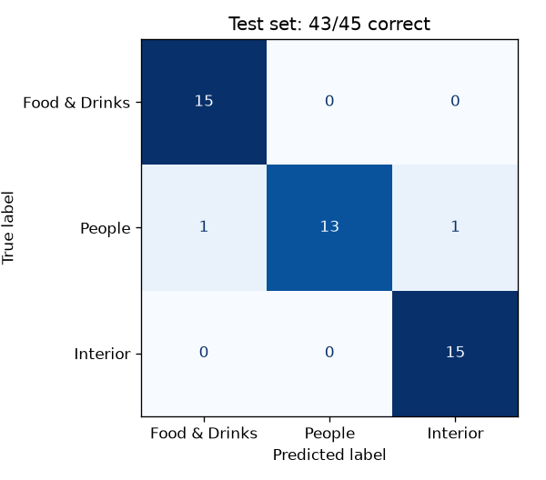

# Café Photo Sorter: technical guide

This is the detailed documentation. For the one-page overview and Quick start, see the
[root README](../README.md).

The tool copies a folder of café photos into three albums, **Food & Drinks**, **People** and **Interior**,
using only the pixels of each photo. Everything runs locally; after a one-time model download it needs no
network.

**Contents:** [How it works](#how-it-works) · [Install](#install) · [Commands](#commands) ·
[Train on your own photos](#train-on-your-own-photos) · [Results](#results) ·
[A difficult example](#a-difficult-example) · [Tests](#tests) · [Project structure](#project-structure) ·
[Limitations](#limitations-and-possible-improvements)

## How it works

```
photo ──► EXIF-upright RGB ──► CLIP ViT-B/32 image encoder (frozen) ──► 512-d embedding ──► logistic regression ──► album
```

1. **Frozen feature extractor.** The image tower of OpenAI's open-source CLIP ViT-B/32 (MIT license) turns each
   photo into an L2-normalised 512-number embedding. It is never fine-tuned; the text tower is not even loaded.
2. **Linear classifier.** A scikit-learn `LogisticRegression` maps the embedding to three probabilities.
   With ~300 training photos, a linear model on frozen features (3 × 513 parameters) is the right size:
   CLIP already separates "a plate of food", "a person" and "a room", and the classifier only has to find
   those directions. Fine-tuning the whole network would overfit.
3. **Only pixels.** Filenames, folder names and EXIF text fields are never used for prediction. The EXIF
   *orientation* tag is applied so rotated phone photos are seen upright. Folder names are used only as
   training/evaluation labels (`test_prediction_ignores_filename` checks this).

### Labels: the main-subject rule and the training audit

Each photo belongs to the album of its **main subject**. The first training set took its Interior photos from
Places365 *coffee_shop*, which labels the **scene** where a photo was taken, not its subject. An audit of all
50 of them found 23 that were really portraits, groups at tables, or coffee close-ups. They were relabelled
(13 → People, 10 → Food & Drinks), and the ambiguous cases, such as storefront exteriors kept as Interior, are
listed with filenames in [data/LABEL_AUDIT.md](data/LABEL_AUDIT.md). The same audit was applied to the
benchmark test split. 171 licensed café photos from Wikimedia Commons were then added, with labels assigned by
main subject before any prediction.

| Training photos | Food & Drinks | People | Interior |
|---|---|---|---|
| First model | 50 | 50 | 50 |
| Retrained: audited original images | 60 | 63 | 27 |
| Retrained: café photos (new) | 56 | 46 | 69 |
| **Retrained total** (`data/train`) | **116** | **109** | **96** |

### Model selection with venue/photographer groups

Photos from the same café, or by the same photographer, look alike. If they land on both sides of a
cross-validation split, the score is optimistic. `train` therefore reads a **group** for every training
photo from `data/manifest.csv` and uses `StratifiedGroupKFold`, so a group is never in the training and
validation part of the same fold.

- **Café photos:** the group is a venue/photographer cluster. Photos that share a photographer or a
  venue-specific Commons category end up in the same group, giving 88 groups for the 171 café photos.
- **Older images:** the group is the Commons category for the old Wikimedia drink photos, and each COCO,
  Places365 and Food-101 image is its own group, since those are independent photos from unknown places.

The search covers C ∈ {0.01, 0.1, 1, 10, 100, 1000} × class_weight ∈ {none, balanced} and is scored by
**balanced accuracy** (mean per-class recall), so a collapsed class cannot hide behind the others.
**Selected for the shipped model: C = 1, class_weight = balanced, 5-fold grouped CV balanced accuracy
0.921 ± 0.031 over 233 groups.** The first model used C = 100, chosen by ordinary (ungrouped) CV accuracy.

## Install

Python 3.11 or newer. CPU-only, two steps (the first gets CPU builds of PyTorch, the second everything else):

```bash
cd sort-photos
python3.11 -m venv .venv && source .venv/bin/activate
python -m pip install torch==2.15.0 torchvision==0.29.2 --index-url https://download.pytorch.org/whl/cpu
python -m pip install -e ".[dev]"        # [dev] adds pytest; plain "-e ." is enough to sort
python -m clip download-model            # one-time, ~340 MB, SHA256-verified, into models/backbone/
```

Step 2 keeps the `+cpu` torch from step 1 (`torch==2.15.0` is satisfied by `2.15.0+cpu`). On a CUDA machine,
skip step 1 or use the matching PyTorch CUDA index; a GPU is used automatically (`--device cpu` forces the CPU).
CI runs exactly these commands ([`.github/workflows/test.yml`](../.github/workflows/test.yml)).

## Commands

All commands run from `sort-photos/`; `python -m clip <command> --help` lists every option.

| Command | What it does |
|---|---|
| `python -m clip download-model` | Downloads the CLIP weights once. **The only command that uses the network.** |
| `python -m clip sort --input DIR --output DIR` | Copies photos into the three albums (details below). |
| `python -m clip evaluate --data DIR --report-dir DIR` | Scores a labelled folder and writes `evaluation.md/.json` + `confusion_matrix.png`. |
| `python -m clip train --data data/train --out models/` | Retrains the classifier with venue-grouped CV. |
| `python -m clip check-duplicates --data DIR --against DIR …` | Finds exact or near-duplicate images between folders. |

Common options: `--model-dir` (default `models/`; `models/baseline` is the first model), `--batch-size`
(positive integer, default 32), `--device`.

### `sort`

```bash
python -m clip sort --input ~/cafe_photos --output ~/cafe_albums
python -m clip sort --input ~/cafe_photos --output ~/cafe_albums --recursive --min-confidence 0.5
```

- **Supported formats:** `.jpg .jpeg .png .webp .bmp .tif .tiff`, in any letter case. EXIF orientation is applied.
- **Copies only.** Each photo is copied with `shutil.copy2` (metadata kept) into `Food & Drinks/`, `People/` or
  `Interior/` under `--output`. Originals are never moved, renamed or modified.
- **Safe output.** The output may not be the input folder, inside it, or contain it. Album folders and
  `predictions.csv` are checked before anything is written; symlinks there (live or dangling) are rejected.
  Each destination is reserved with an exclusive create, so existing files and links count as name clashes
  (`photo_1.jpg`, `photo_2.jpg`, …) and are never written through.
- **Bad files.** Corrupt or non-image files are skipped with a warning and listed in the summary.
- **Failed copies** (source vanished, disk full, I/O error): the empty or partial destination is deleted, the
  photo is listed with the original error, and sorting continues with the next photo.
- **`predictions.csv`:** `original_path, album, confidence, low_confidence, copied_to, p_food_drinks, p_people,
  p_interior`, written to a temporary file and atomically renamed.
- **`--min-confidence`:** photos below the threshold are still copied to their best album but flagged in
  the CSV and the console summary.
- **`--recursive`:** include sub-folders. Photos are classified in batches with a progress bar.

**Exit status**

| Code | Meaning |
|---|---|
| `0` | Success. Also when some files were skipped (corrupt, non-image) or some copies failed but at least one succeeded. |
| `1` | Copies were attempted and **every one failed**; the number of failures is printed. No incomplete files are left behind. |
| `2` | Invalid arguments (e.g. `--batch-size 0`), unsafe input/output paths, or a missing model/backbone. |

### Offline behaviour

`download-model` stores the checkpoint at `models/backbone/ViT-B-32.pt`. Every other command loads it only
from there, never downloads anything, sets `HF_HUB_OFFLINE=1` and `TRANSFORMERS_OFFLINE=1`, and fails with a
clear message if the file is missing. This was verified by running `train`, `evaluate` and `sort` with the
network removed at the OS level:

```bash
HF_HUB_OFFLINE=1 TRANSFORMERS_OFFLINE=1 unshare -rn python -m clip sort --input ~/cafe_photos --output ~/cafe_albums
```

## Train on your own photos

Put labelled photos in one folder per class. Sub-folders inside a class folder are fine: the class is
always the **top-level** folder under `--data`.

```
my_cafe/
├── train/
│   ├── food_drinks/
│   │   ├── latte.jpg
│   │   └── 2024-05/latte.jpg      # same file name as above, in a sub-folder
│   ├── people/
│   │   └── barista_anna.jpg
│   └── interior/
│       └── window_seats.jpg
└── manifest.csv                    # optional: CV groups (picked up automatically from <data>/../manifest.csv)
```

`manifest.csv` needs the columns `class,filename,group`; other columns are ignored. `filename` is the path
inside the class folder. A bare file name also works when it is unique within its class. `group` is the venue,
shoot or photographer, so similar photos stay in the same CV fold:

```csv
class,filename,group
food_drinks,latte.jpg,cafe-rosa
food_drinks,2024-05/latte.jpg,cafe-rosa
people,barista_anna.jpg,cafe-rosa
interior,window_seats.jpg,cafe-milano
```

```bash
python -m clip train --data my_cafe/train --out models/my_cafe                # grouped CV, uses my_cafe/manifest.csv
python -m clip train --data my_cafe/train --out models/my_cafe --no-groups    # plain stratified CV, no manifest needed
python -m clip sort --input ~/new_photos --output ~/albums --model-dir models/my_cafe
```

Training stops with a clear error, writing **no** model files, when:
- a class has fewer readable images than `--folds` (default 5);
- a photo has no group;
- a bare file name matches several photos of one class;
- the manifest lists the same photo with two different groups.

Grouped CV also needs at least `--folds` groups. To add your photos to the shipped data instead, copy them
into `data/train/<class>/` and add `class,filename,group` rows to `data/manifest.csv`.

## Results

### Three evaluation sets, and why they differ

| Set | Photos | Role |
|---|---|---|
| **`data/holdout_fresh`** | 45 (15 per class) | **The main result.** Café photos from 35 venue/photographer groups not used for training or model selection; labels frozen before any prediction. |
| `data/holdout_cafe` | 45 (15 per class) | Earlier café holdout. It was inspected while diagnosing the first model, so it is now only a **diagnostic** set. None of its photos or photographers are in training. |
| `data/test` | 45 | **Historical benchmark** from the original dataset (COCO, Places365, Food-101). Its sources match the first model's training data, so it is easy and was misleading. |

### Fresh café holdout: 25 / 45 → **43 / 45**

Both models, same 45 photos, run offline:

```bash
python -m clip evaluate --data data/holdout_fresh --report-dir reports/holdout_fresh
python -m clip evaluate --data data/holdout_fresh --report-dir reports/holdout_fresh/baseline --model-dir models/baseline
```

| | First model (`models/baseline`) | Retrained (`models/`, default) |
|---|---|---|
| **Correct** | 25 / 45 (55.6%) | **43 / 45 (95.6%)** |
| Food & Drinks: precision / recall | 1.000 / 0.667 (10 / 15) | 0.938 / **1.000 (15 / 15)** |
| **People: precision / recall** | 0.000 / **0.000 (0 / 15)** | 1.000 / **0.867 (13 / 15)** |
| Interior: precision / recall | 0.429 / 1.000 (15 / 15) | 0.938 / 1.000 (15 / 15) |
| Single-subject / mixed-subject photos | 23 / 39, 2 / 6 | 39 / 39, 4 / 6 |

Confusion matrices (rows = true album; columns = predicted Food & Drinks, People, Interior):

| First model | Retrained |
|---|---|
| Food & Drinks: 10, 0, 5 | Food & Drinks: **15**, 0, 0 |
| People: 0, **0**, 15 | People: 1, **13**, 1 |
| Interior: 0, 0, 15 | Interior: 0, 0, **15** |



Full reports: [retrained](reports/holdout_fresh/evaluation.md) · [first model](reports/holdout_fresh/baseline/evaluation.md).

**What changed.**
- The first model sent all 15 café People photos to Interior. Interior was its default answer for anything
  taken inside a café, which is why its Interior recall was perfect but its precision only 0.43.
- The retrained model fixes People (13 / 15) and Food & Drinks (15 / 15) without losing any Interior photos.
- Both remaining errors are mixed-subject People photos (see [below](#a-difficult-example)).

**About the set.**
- 45 Wikimedia Commons café photos under CC0, public-domain, CC BY or CC BY-SA terms, 15 per class, 6 of them
  mixed-subject.
- They come from **35 venue/photographer groups**. None of those groups, photographers or venue categories
  appear in the training data or in `holdout_cafe`.
- The `venue` field is filled for only 6 of the 45 photos (for example Caffè Giardino, Café Guarany,
  Konditorei Buchwald) and blank for the other 39. Commons often does not record the café, so separation
  relies on the group, which combines photographer and Commons categories.
- `check-duplicates` found 0 exact, perceptual-hash or near-duplicate (CLIP cosine ≥ 0.95) matches against
  train, test and `holdout_cafe`. The closest pair (cosine 0.938) is two different latte cups.
- Labels were frozen at 2026-11-15T13:35:09Z, before any prediction. Source, author, license and label reason
  for every photo are in [`data/holdout_fresh/manifest.csv`](data/holdout_fresh/manifest.csv).

**How much to trust it.** 45 photos is a small sample: each photo is worth 2.2 percentage points, and
43 / 45 is statistically consistent with a true accuracy anywhere from roughly 85% to 99%. The People result
rests on 15 photos. What the set does show clearly is the size of the change. The first model got *no*
café People photo right, and the retrained one gets most of them, on photos from cafés it has never seen.
These are public Commons photos, often well composed. A café owner's phone photos of one place may score
differently, and the best next test is a reviewer's own labelled photos ([commands](#evaluate-your-own-labelled-photos)).

### Diagnostic set (`holdout_cafe`): 26 / 45 → 43 / 45

| | First model | Retrained |
|---|---|---|
| Correct | 26 / 45 (57.8%) | 43 / 45 (95.6%) |
| Food & Drinks / People / Interior recall | 0.667 / 0.067 / 1.000 | 0.933 / 0.933 / 1.000 |

Reports: [retrained](reports/holdout_cafe/evaluation.md) · [first model](reports/holdout_cafe/baseline/evaluation.md).
Not a clean test (see above), but consistent with the fresh holdout.

### Historical benchmark (`data/test`)

| Labels | First model | Retrained |
|---|---|---|
| Original source labels | 45 / 45 | 40 / 45 |
| **Audited by main subject** (current files) | 41 / 45 | **44 / 45** |

In this split every People photo comes from COCO and every Interior photo from Places365 *coffee_shop*, the
same sources the first model was trained on, so it could score well by recognising the source dataset. With
the original scene labels the retrained model looks worse: it calls 4 "Interior" photos People or Food &
Drinks. An audit of all 14 test Interior photos found that exactly those 4 show people or a latte as the main
subject; the first model had put them in Interior with 0.98–0.99 confidence. That audit was done *after* the
retrained predictions had been seen, so both rows are reported ([data/LABEL_AUDIT.md](data/LABEL_AUDIT.md)).
Reports: [retrained](reports/evaluation.md) · [first model](reports/baseline/evaluation.md).

**A hard benchmark photo (first numbers: baseline model, previous round).** The next hardest photo is a correct prediction: `data/test/people/4eda754771ad4d60ba25939c7b1efa9f.jpg`
got People 0.69 / Interior 0.30. It is a vintage black-and-white snapshot of two people on an armchair
in a living room, with striped curtains, cushions and furniture all around. The people are clearly the subject,
but so much of the furnished room is visible that part of the probability goes to Interior. With `--min-confidence 0.7` it was the
one photo flagged in the demo run. The retrained model is more decided on this photo:
People 0.86 / Interior 0.07.

### Evaluate your own labelled photos

Put them in `food_drinks/`, `people/` and `interior/` sub-folders (any filenames), then:

```bash
python -m clip check-duplicates --data /path/to/my_photos --against data/train data/test
python -m clip evaluate --data /path/to/my_photos --report-dir reports/mine
python -m clip evaluate --data /path/to/my_photos --report-dir reports/mine/baseline --model-dir models/baseline
```

To reproduce every report in `reports/` (offline, a few minutes on a CPU):

```bash
python -m clip evaluate --data data/holdout_fresh --report-dir reports/holdout_fresh
python -m clip evaluate --data data/holdout_fresh --report-dir reports/holdout_fresh/baseline --model-dir models/baseline
python -m clip evaluate --data data/holdout_cafe  --report-dir reports/holdout_cafe
python -m clip evaluate --data data/holdout_cafe  --report-dir reports/holdout_cafe/baseline --model-dir models/baseline
python -m clip evaluate --data data/test
python -m clip evaluate --data data/test --report-dir reports/baseline --model-dir models/baseline
python -m clip train --data data/train --out models/   # reproduces models/classifier.* (C = 1, balanced)
```

## A difficult example


`data/holdout_fresh/people/892fa8fabd4e8354d8251600.jpg`, from the fresh holdout.

- **Expected:** People (labelled before inference, marked mixed-subject)
- **Predicted:** Food & Drinks, by a hair

| | Food & Drinks | People | Interior |
|---|---|---|---|
| Retrained | **0.41** | 0.37 | 0.22 |
| First model | 0.00 | 0.00 | **1.00** |

A barista works an espresso machine. Her face is out of frame, and her arm, bracelets and black shirt fill
the right third of the photo. The chrome machine, portafilter and cups fill the rest. "Someone making
coffee" counts as People under the main-subject rule, but most of the pixels are coffee equipment, which the
training data associates with drinks. The retrained model's near three-way split reflects that ambiguity,
while the first model was certain it was Interior. With `--min-confidence 0.5` this photo would be flagged for
review instead of silently mis-filed. The other remaining error is a crowded outdoor café terrace (People,
predicted Interior 0.67). There is no Exterior album, and café exteriors in training are labelled Interior.

## Tests

```bash
python -m pytest
```

51 tests. They use tiny generated images and a colour-based stand-in for CLIP, so they run in about a second
without the model download. They cover:
- **sorting:** originals unchanged (SHA-256), three albums, corrupt/non-image files skipped, name collisions,
  `predictions.csv`, `--min-confidence`, filename independence, EXIF orientation;
- **safety:** symlinked CSV or albums, dangling links, atomic CSV writes, failed and partial copies;
- **CLI exit status:** `1` when every copy fails, with no partial files left; `0` for partial failures and for
  corrupt-only folders;
- **argument validation and training data checks;**
- **group resolution** for flat and nested training folders, including ambiguous and conflicting manifest rows;
- **the duplicate checker.**

## Project structure

```
sort-photos/
├── clip/                    # the package (python -m clip ...)
│   ├── __main__.py          # entry point
│   ├── cli.py               # argparse CLI: download-model / train / evaluate / check-duplicates / sort
│   ├── config.py            # classes, album names, paths, seeds, CV settings, device
│   ├── clip.py              # backbone download (only network use) + local-only loading + preprocessing
│   ├── model.py             # CLIP ViT image encoder (text tower removed)
│   ├── features.py          # image decoding (EXIF orientation, corrupt-file handling) + batched embedding
│   ├── train.py             # label/group resolution, venue-grouped CV over C/class_weight, final fit, artifact
│   ├── predict.py           # PhotoClassifier: embeddings -> class probabilities
│   ├── evaluate.py          # metrics, confusion matrix, Markdown/JSON report
│   ├── duplicates.py        # exact / perceptual-hash / embedding near-duplicate detection between folders
│   ├── sorter.py            # sort a folder: classify, copy into albums, write predictions.csv
│   └── fileops.py           # file discovery, folder validation, collision-safe copying
├── data/
│   ├── train/               # 321 labelled training photos (food_drinks/, people/, interior/)
│   ├── test/                # 45-photo historical benchmark
│   ├── manifest.csv         # train/test: source, author, license, venue, CV group, label reason
│   ├── holdout_fresh/       # 45 fresh café photos (35 venue/photographer groups) + manifest.csv
│   ├── holdout_cafe/        # 45 café photos, diagnostic set + manifest.csv
│   └── LABEL_AUDIT.md       # labelling rule and every label change
├── models/
│   ├── classifier.joblib, classifier.json   # retrained model, used by default
│   ├── baseline/            # the first model, kept for comparison
│   └── backbone/            # CLIP weights (git-ignored, from download-model)
├── reports/                 # data/test reports; holdout_fresh/, holdout_cafe/; */baseline/ = first model
├── tests/                   # conftest.py, test_sort.py, test_safety.py, test_validation.py
├── requirements.txt         # pinned
└── setup.py
```

## Limitations and possible improvements

- **Small held-out sets.** See "How much to trust it" under [Results](#results). The owner's own
  labelled photos are the most valuable next evaluation.
- **Commons is not the owner's camera.** Adding 10–20 of the owner's labelled photos per album to `data/train`
  (with a group per shoot) and re-running `train` is the cheapest improvement.
- **Single annotator.** All labels and audits are by one annotator ([data/LABEL_AUDIT.md](data/LABEL_AUDIT.md));
  mixed scenes are a matter of judgement.
- **One album per photo.** A barista holding a latte is both People and Food & Drinks. Options: multi-label
  output, or an "Unsure" album for low-confidence photos.
- **Softer probabilities.** C = 1 is more regularised than the first model's C = 100, so confidences are lower.
  In an offline sort of 90 holdout photos, `--min-confidence 0.7` flagged 32 (all still copied); 0.5 flags only
  near-ties.
- **No Exterior/Other album.** Storefronts, terraces and menus are forced into one of the three albums.
- **Bigger backbones.** `--backbone ViT-B/16` or `ViT-L/14` (with `download-model --backbone ...`) usually give
  better embeddings at the cost of speed and download size.

## License and credits

The image-encoder code in `clip/model.py` and `clip/clip.py` is adapted from
[OpenAI CLIP](https://github.com/openai/CLIP) (MIT, see [LICENSE](LICENSE)). The source, author and license of
every photo are listed in [`data/manifest.csv`](data/manifest.csv),
[`data/holdout_cafe/manifest.csv`](data/holdout_cafe/manifest.csv) and
[`data/holdout_fresh/manifest.csv`](data/holdout_fresh/manifest.csv). Photos are reused under their Creative
Commons or public-domain terms.
