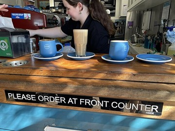

# Café Photo Sorter

A small command-line tool that sorts a café owner's folder of mixed photos into three albums,
**Food & Drinks**, **People** and **Interior**, based only on what is in each picture.
Originals are never touched: every photo is *copied* into its predicted album.

Everything runs locally in Python. After a one-time model download the tool works fully offline.

## Approach

```
photo ──► EXIF-upright RGB ──► CLIP ViT-B/32 image encoder (frozen) ──► 512-d embedding ──► logistic regression ──► album
```

1. **Feature extractor**: the image tower of OpenAI's open-source CLIP ViT-B/32 (MIT license),
   used frozen. Each photo becomes an L2-normalised 512-dimensional embedding.
2. **Classifier**: a scikit-learn `LogisticRegression` trained on those embeddings. Its
   regularisation strength `C` is chosen with 5-fold stratified cross-validation on the training set.

**Why this works with only 50 photos per class.** CLIP was pretrained on ~400M image–text pairs,
so its embeddings already separate concepts like "a plate of food", "a person" and "a room".
Fine-tuning a deep network on 150 images would overfit badly. A linear model on frozen features has
only 3 × 513 parameters, trains in under a second, and only needs to find the directions in
embedding space that the backbone already encodes. This is the standard "linear probe" setup.

**Only pixels are used.** Predictions depend on decoded pixel data alone. Filenames, folder names
and EXIF text fields are never read for classification. The EXIF *orientation* tag is applied so
that rotated phone photos are seen upright. During training and evaluation, folder names are used
only as labels. A test (`test_prediction_ignores_filename`) checks this.

## Setup

Requires **Python 3.11 or newer**. CPU-only install in two steps:

```bash
cd sort-photos
python3.11 -m venv .venv && source .venv/bin/activate
# 1. CPU builds of the pinned torch/torchvision from the PyTorch index
python -m pip install torch==2.15.0 torchvision==0.29.2 --index-url https://download.pytorch.org/whl/cpu
# 2. this project + the remaining pinned dependencies (requirements.txt) from PyPI; [dev] adds pytest
python -m pip install -e ".[dev]"
```

Step 2 keeps the `+cpu` torch from step 1, because `torch==2.15.0` is satisfied by `2.15.0+cpu`.
For a CUDA machine, skip step 1 (or use the matching PyTorch CUDA index). A GPU is used automatically
when available, and `--device cpu` forces the CPU. These exact commands run in CI
(`../.github/workflows/test.yml`) and were checked in a fresh Python 3.11 venv.

## Usage

All commands are run from the `sort-photos/` folder. `python -m clip <command> --help` lists all options.

```bash
# 1. One-time download of the backbone weights (~340 MB) into models/backbone/ (SHA256-verified).
#    This is the only command that uses the network.
python -m clip download-model

# 2. Retrain the classifier on data/train/<class>/ -> models/classifier.joblib + models/classifier.json
python -m clip train --data data/train --out models/

# 3a. Evaluate on the benchmark test split -> console + reports/evaluation.md + reports/confusion_matrix.png
python -m clip evaluate --data data/test
# 3b. Evaluate on the held-out café photos
python -m clip evaluate --data data/holdout_cafe --report-dir reports/holdout_cafe

# 4. Sort your own photos
python -m clip sort --input ~/Pictures/cafe --output ~/Pictures/cafe_albums [--recursive] [--min-confidence 0.7]
```

`--batch-size` must be a positive integer, `--folds` at least 2, and `--min-confidence` between 0 and 1.
Invalid values are rejected with exit code 2 before anything runs. `train` checks *after decoding* that
every class has at least `--folds` readable images (corrupt files don't count) and stops before writing
any model file if not. `evaluate` stops with an error if no test image can be read.

What `sort` does:

- creates `Food & Drinks/`, `People/` and `Interior/` inside `--output` and **copies**
  (`shutil.copy2`) each photo into its predicted album. Originals are never moved, renamed or modified.
- refuses an output folder that is the input folder, inside it, or contains it.
- validates everything it will write **before** creating or copying anything: an album path or
  `predictions.csv` that is a symlink (live or dangling) or the wrong file type is rejected, so a write
  can never be redirected onto an original.
- reserves each destination with an exclusive create, so an existing file or symlink, even a dangling
  one, is treated as a name collision and never written through. Collisions get `_1`, `_2`, …
  (for example with `--recursive`, or when re-running into the same output).
- accepts `.jpg .jpeg .png .webp .bmp .tif .tiff` in any letter case, and applies EXIF orientation.
- skips corrupt or non-image files with a warning instead of crashing.
- classifies in batches (`--batch-size`, default 32) with a progress bar.
- writes `predictions.csv` (`original_path, album, confidence, low_confidence, copied_to, p_food_drinks, p_people, p_interior`)
  to a temporary file in the output folder, then atomically renames it into place.
- with `--min-confidence`, photos whose top probability is below the threshold are still copied to
  their best album, but are flagged in the CSV and listed in the console summary.
- prints a summary: photos per album, low-confidence photos, skipped files.

### Offline use

`download-model` stores the checkpoint at `models/backbone/ViT-B-32.pt`. `train`, `evaluate` and
`sort` load it **only** from that path. They never download anything and fail with a clear message
if the file is missing. They also set `HF_HUB_OFFLINE=1` and `TRANSFORMERS_OFFLINE=1`. This was
verified by running `sort` with the network removed at the OS level:

```bash
HF_HUB_OFFLINE=1 TRANSFORMERS_OFFLINE=1 unshare -rn python -m clip sort --input demo_in --output demo_out
```

### Tests

```bash
python -m pytest
```

The tests use tiny generated images and a colour-based stand-in for CLIP, so they run in seconds
without the backbone. They cover:
- originals unchanged after sorting (SHA256 of every file), three albums created, corrupt/truncated/non-image
  files skipped, filename collisions, the predictions CSV and low-confidence flag, filename independence,
  EXIF orientation, and building the image encoder from a checkpoint;
- **symlink safety** (`tests/test_safety.py`): a `predictions.csv` symlink to an input photo, album symlinks
  (to the input, elsewhere, or dangling), live and dangling symlinks inside an album, atomic CSV writes,
  and input-inside-output;
- **validation** (`tests/test_validation.py`): non-positive or non-numeric `--batch-size` for
  `train`/`evaluate`/`sort`, invalid `--folds`/`--min-confidence`, a class whose training images are all
  corrupt (`train` fails and writes no artifacts), fewer readable images than folds, an evaluation with
  zero readable images, and the duplicate checker.

## Project structure

```
sort-photos/
├── clip/                    # the package (python -m clip ...)
│   ├── __main__.py          # entry point
│   ├── cli.py               # argparse CLI: download-model / train / evaluate / check-duplicates / sort
│   ├── config.py            # classes, album names, paths, seeds, device
│   ├── clip.py              # backbone download (only network use) + local-only loading + preprocessing
│   ├── model.py             # CLIP ViT image encoder (text tower removed)
│   ├── features.py          # image decoding (EXIF orientation, corrupt-file handling) + batched embedding
│   ├── train.py             # readable-count checks, stratified CV over C, final fit, saving the model artifact
│   ├── predict.py           # PhotoClassifier: embeddings -> class probabilities
│   ├── evaluate.py          # metrics, confusion matrix, Markdown/JSON report
│   ├── duplicates.py        # exact / perceptual-hash / embedding near-duplicate detection between folders
│   ├── sorter.py            # sort a folder: classify, copy into albums, write predictions.csv
│   └── fileops.py           # file discovery, folder validation, collishttps://www.hellojob.az/vakansiya/ai-layiheleri-uzre-texniki-assistention-safe copying
├── data/
│   ├── train/, test/        # food_drinks/, people/, interior/ (50 + 15 each) + manifest.csv (sources, licenses)
│   ├── holdout_cafe/        # 45 real café photos (15 per class), manifest.csv with provenance + labels
│   └── LABEL_AUDIT.md       # labelling rule, the one label change, known label noise
├── models/                  # classifier.joblib, classifier.json (classes, backbone name + SHA256, C, CV scores, versions); backbone/ is git-ignored
├── reports/                 # evaluation.md/json, confusion_matrix.png (benchmark split); holdout_cafe/ (café holdout)
├── tests/                   # conftest.py, test_sort.py, test_safety.py, test_validation.py
├── requirements.txt         # pinned
└── setup.py
```

## Results

Backbone CLIP ViT-B/32 (frozen) + logistic regression, seed 42, CPU. The same classifier is used
for every evaluation below.

**Cross-validation on the training set** (150 images, 5-fold stratified, used to choose `C`):

| C | 0.01 | 0.1 | 1 | 10 | **100** | 1000 |
|---|---|---|---|---|---|---|
| mean accuracy | 0.913 | 0.913 | 0.927 | 0.940 | **0.947** | 0.947 |

`C = 100` was selected (ties are broken in favour of the first, i.e. the smaller, value). Model
selection uses `data/train` only. Neither test set influenced it.

### 1. Original benchmark split (`data/test`): 44 / 45 → 45 / 45 after the label audit

The original split scores **44 / 45 (97.8%)** with its original labels. That number was reported by the
previous version of this README and reproduced in this revision before the audit. The one error was a
Places365 *coffee_shop* photo labelled Interior that shows a pastry display case:


Predicted Food & Drinks 0.92 / People 0.00 / Interior 0.08. Places365 labels the *scene*, but the
album rule is the *main subject*, and pastries fill almost the whole frame. The label was changed to
`food_drinks` (reason recorded in [data/LABEL_AUDIT.md](data/LABEL_AUDIT.md)). With the corrected label
the same model scores **45 / 45**:

| Album | Precision | Recall | F1 | Test images |
|---|---|---|---|---|
| Food & Drinks | 1.000 | 1.000 | 1.000 | 16 |
| People | 1.000 | 1.000 | 1.000 | 15 |
| Interior | 1.000 | 1.000 | 1.000 | 14 |


**This split is too easy to trust.** In both train and test, *every* People photo comes from COCO and
*every* Interior photo from Places365 *coffee_shop*. A classifier can therefore score well by telling
the source datasets apart, which is not the café owner's problem. Section 2 tests that directly.

The next hardest photo is a correct prediction: `data/test/people/4eda754771ad4d60ba25939c7b1efa9f.jpg`
got People 0.69 / Interior 0.30. It is a vintage black-and-white snapshot of two people on an armchairhttps://www.hellojob.az/vakansiya/ai-layiheleri-uzre-texniki-assistent
in a living room, with striped curtains, cushions and furniture all around. The people are clearly the subject,
but so much of the furnished room is visible that part of the probability goes to Interior. With `--min-confidence 0.7` it was the
one photo flagged in the demo run.

### 2. Held-out café photos (`data/holdout_cafe`): 26 / 45 correct (57.8%)

**The set.** 45 real café photos from Wikimedia Commons, 15 per class. 14 of them are mixed-subject
scenes, such as a person with a coffee, drinks on a counter with a barista behind, or a room with customers.
- **Provenance.** Every file comes from café, barista and café-food categories, has a reusable license
  (CC0, public domain, CC BY, CC BY-SA), and is listed in `data/holdout_cafe/manifest.csv` with its
  title, page URL, author, license and label reason. Files are the 500-px thumbnails served by Commons.
- **Labels.** Assigned by main subject from the images **before any prediction was run**
  (`labeled_at_utc`). See the annotator note in `data/LABEL_AUDIT.md`.
- **Leakage checks.** None of the photos or their venue categories appear among the Commons files in
  train/test. `python -m clip check-duplicates --data data/holdout_cafe --against data/train data/test`
  found **0** exact, perceptual-hash (dHash ≤ 6) or embedding (cosine ≥ 0.95) duplicates among the 195
  train+test images. The closest pair had cosine 0.895 (two different coffee cups) and the smallest dHash
  distance was 14. The same check found no near-duplicates *within* the holdout.
- **No tuning.** The holdout was evaluated once with the shipped classifier and was not used to choose
  anything.

| Album | Precision | Recall | F1 | Photos |
|---|---|---|---|---|
| Food & Drinks | 0.909 | 0.667 | 0.769 | 15 |
| People | 1.000 | 0.067 | 0.125 | 15 |
| Interior | 0.455 | 1.000 | 0.625 | 15 |

| true \ predicted | Food & Drinks | People | Interior |
|---|---|---|---|
| Food & Drinks | 10 | 0 | 5 |
| People | 1 | 1 | 13 |
| Interior | 0 | 0 | 15 |

Single-subject photos: 20 / 31 correct. Mixed-subject photos: 6 / 14 correct.
Full report: [reports/holdout_cafe/evaluation.md](reports/holdout_cafe/evaluation.md).

**What goes wrong.** Almost everything taken inside a café is predicted Interior. Only 1 of 15 People
photos is right, and even a plain portrait of a barista behind the counter gets Interior 0.97.
This is the source bias from section 1. The model learned "COCO-style person → People" and
"café scene → Interior", because the training Interior class is all Places365 *coffee_shop* scenes,
many of which contain baristas, customers and cups. Close-up coffee cups on café tables (5 of 15
Food & Drinks) are pulled toward Interior for the same reason. Interior itself is 15 / 15, but only
because Interior is the default answer for café scenes (precision 0.455).

### Evaluating reviewer photos

Put the labelled photos in `food_drinks/`, `people/` and `interior/` sub-folders (any filenames), then:

```bash
python -m clip check-duplicates --data /path/to/reviewer_photos --against data/train data/test
python -m clip evaluate --data /path/to/reviewer_photos --report-dir reports/reviewer
```

## A difficult example



`data/holdout_cafe/food_drinks/d118c1a3090dfead522cb4d9.jpg`, labelled **Food & Drinks** before
prediction (`mixed_subject=yes`), predicted **Interior**:

| Food & Drinks | People | Interior |
|---|---|---|
| 0.03 | 0.00 | **0.97** |

Three cups and a glass of iced coffee sit on a wooden pick-up counter in the foreground, with a
"PLEASE ORDER AT FRONT COUNTER" sign. A barista works at the espresso machine behind them, and the bar
fills the rest of the frame. Every album has a claim: the drinks are closest to the camera and are the
reason the photo was taken (our label), the barista is the only person, and the counter is café
interior. The model's answer is defensible in isolation. But its confidence (0.97) and its People score
(0.00, with a person clearly visible) show the bias above: it reads "café counter" as Interior regardless
of what is on it.

## Limitations and possible improvements

- **Source bias in the training data (the main problem).** See section 2: 26 / 45 on real café photos.
  The most direct fix is better training data. Add café-context People photos (baristas, customers at
  tables) and close-up café Food & Drinks photos, and relabel the Places365 Interior images by main
  subject (some show cups or people; see `data/LABEL_AUDIT.md`). Then evaluate on a **new** holdout,
  because this one has now been inspected.
- **Small test sets.** 45 images per set means each error moves accuracy by 2.2 points. Both numbers
  have wide uncertainty.
- **Single-label albums.** Every photo goes to exactly one album. A barista holding a latte is both
  "People" and "Food & Drinks". Possible fixes: multi-label output (copy to every album above a
  threshold) or an "Unsure" album for low-confidence photos.
- **Annotator.** Holdout labels come from one annotator. A café owner may disagree on mixed scenes.
- **Fixed classes.** A photo of the menu board, the storefront or a dog is still forced into one of
  the three albums. A fourth "Other" class or an embedding-distance reject option would help.
- **Bigger backbones.** `--backbone ViT-B/16` or `ViT-L/14` (with `download-model --backbone ...`)
  usually give better embeddings, at the cost of speed and download size. DINOv2 or SigLIP would also
  fit behind the same `Embedder` interface.
- **Calibration.** Probabilities are over-confident: holdout errors reach 0.97–1.00. `--min-confidence`
  cannot catch confident mistakes. Temperature scaling on a validation set would help, but not with the
  bias above.

## License and credits

The image-encoder code in `clip/model.py` and `clip/clip.py` is adapted from
[OpenAI CLIP](https://github.com/openai/CLIP) (MIT, see `LICENSE`). The sources and licenses of every
photo are listed in `data/manifest.csv` and `data/holdout_cafe/manifest.csv`. Holdout photos are
reused under their Creative Commons / public-domain terms, with author and license per file in that manifest.
