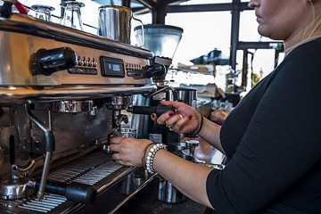

# Café Photo Sorter

A small command-line tool that sorts a café owner's folder of mixed photos into three albums,
**Food & Drinks**, **People** and **Interior**, based only on what is in each picture.
Originals are never touched: every photo is *copied* into its predicted album.

Everything runs locally in Python. After a one-time model download the tool works fully offline.

## Approach

```
photo ──► EXIF-upright RGB ──► CLIP ViT-B/32 image encoder (frozen) ──► 512-d embedding ──► logistic regression ──► album
```

1. **Feature extractor**: the image tower of OpenAI's open-source CLIP ViT-B/32 (MIT license),
   used frozen. Each photo becomes an L2-normalised 512-dimensional embedding.
2. **Classifier**: a scikit-learn `LogisticRegression` trained on those embeddings. `C` and
   `class_weight` are chosen by 5-fold cross-validation **grouped by venue or source collection**
   (`StratifiedGroupKFold`, groups from the `group` column of `data/manifest.csv`), scored by balanced
   accuracy (mean per-class recall). A venue never appears on both sides of a fold, so the score
   estimates performance at an unseen café.

**Why a linear probe works with a few hundred photos.** CLIP was pretrained on ~400M image–text pairs,
so its embeddings already separate concepts like "a plate of food", "a person" and "a room".
Fine-tuning a deep network on ~300 images would overfit badly. A linear model on frozen features has
only 3 × 513 parameters, trains in seconds, and only needs to find the directions in embedding space
that the backbone already encodes. What matters is that the *training photos look like the owner's
photos*. The first shipped model learned from generic datasets and failed on real café photos
(see [Results](#results)).

**Only pixels are used.** Predictions depend on decoded pixel data alone. Filenames, folder names
and EXIF text fields are never read for classification. The EXIF *orientation* tag is applied so
that rotated phone photos are seen upright. Folder names are used only as labels, and manifest groups
only to split cross-validation folds. A test (`test_prediction_ignores_filename`) checks this.

## Setup

Requires **Python 3.11 or newer**. CPU-only install in two steps:

```bash
cd sort-photos
python3.11 -m venv .venv && source .venv/bin/activate
# 1. CPU builds of the pinned torch/torchvision from the PyTorch index
python -m pip install torch==2.15.0 torchvision==0.29.2 --index-url https://download.pytorch.org/whl/cpu
# 2. this project + the remaining pinned dependencies (requirements.txt) from PyPI; [dev] adds pytest
python -m pip install -e ".[dev]"
```

Step 2 keeps the `+cpu` torch from step 1, because `torch==2.15.0` is satisfied by `2.15.0+cpu`.
For a CUDA machine, skip step 1 (or use the matching PyTorch CUDA index). A GPU is used automatically
when available, and `--device cpu` forces the CPU. These exact commands run in CI
(`../.github/workflows/test.yml`) and were checked in a fresh Python 3.11 venv.

## Usage

All commands are run from the `sort-photos/` folder. `python -m clip <command> --help` lists all options.

```bash
# 1. One-time download of the backbone weights (~340 MB) into models/backbone/ (SHA256-verified).
#    This is the only command that uses the network.
python -m clip download-model

# 2. Retrain on data/train/<class>/ with venue-grouped CV (groups from data/manifest.csv)
#    -> models/classifier.joblib + models/classifier.json
python -m clip train --data data/train --out models/

# 3. Evaluate (console + <report-dir>/evaluation.md/.json + confusion_matrix.png)
python -m clip evaluate --data data/holdout_fresh --report-dir reports/holdout_fresh   # fresh café holdout
python -m clip evaluate --data data/holdout_cafe  --report-dir reports/holdout_cafe    # diagnostic café set
python -m clip evaluate --data data/test                                               # benchmark split
#    the first shipped classifier is kept for comparison: add --model-dir models/baseline

# 4. Sort your own photos
python -m clip sort --input ~/Pictures/cafe --output ~/Pictures/cafe_albums [--recursive] [--min-confidence 0.7]

# check an evaluation folder for exact / near-duplicates of the training data
python -m clip check-duplicates --data data/holdout_fresh --against data/train data/test data/holdout_cafe
```

`--batch-size` must be a positive integer, `--folds` at least 2, and `--min-confidence` between 0 and 1.
Invalid values are rejected with exit code 2 before anything runs. `train` checks *after decoding* that
every class has at least `--folds` readable images (corrupt files don't count), and that every image has a
group when grouping is used. If not, it stops before writing any model file (`--no-groups` falls back to
plain stratified CV). `evaluate` stops with an error if no test image can be read.

What `sort` does:

- creates `Food & Drinks/`, `People/` and `Interior/` inside `--output` and **copies**
  (`shutil.copy2`) each photo into its predicted album. Originals are never moved, renamed or modified.
- refuses an output folder that is the input folder, inside it, or contains it.
- validates everything it will write **before** creating or copying anything: an album path or
  `predictions.csv` that is a symlink (live or dangling) or the wrong file type is rejected, so a write
  can never be redirected onto an original.
- reserves each destination with an exclusive create, so an existing file or symlink, even a dangling
  one, is treated as a name collision and never written through. Collisions get `_1`, `_2`, …
- if a copy fails (the source vanished, disk full, I/O error), deletes the empty or partial destination it
  created, lists the photo under *Skipped* with the original error, and continues with the next photo.
- accepts `.jpg .jpeg .png .webp .bmp .tif .tiff` in any letter case, and applies EXIF orientation.
- skips corrupt or non-image files with a warning instead of crashing.
- classifies in batches (`--batch-size`, default 32) with a progress bar.
- writes `predictions.csv` (`original_path, album, confidence, low_confidence, copied_to, p_food_drinks, p_people, p_interior`)
  to a temporary file in the output folder, then atomically renames it into place.
- with `--min-confidence`, photos whose top probability is below the threshold are still copied to
  their best album, but are flagged in the CSV and listed in the console summary.
- prints a summary: photos per album, low-confidence photos, skipped files.


### Offline use

`download-model` stores the checkpoint at `models/backbone/ViT-B-32.pt`. `train`, `evaluate` and
`sort` load it **only** from that path. They never download anything and fail with a clear message
if the file is missing. They also set `HF_HUB_OFFLINE=1` and `TRANSFORMERS_OFFLINE=1`. This was
verified by running `sort` with the network removed at the OS level:

```bash
HF_HUB_OFFLINE=1 TRANSFORMERS_OFFLINE=1 unshare -rn python -m clip sort --input demo_in --output demo_out
```

### Tests

```bash
python -m pytest
```

The tests use tiny generated images and a colour-based stand-in for CLIP, so they run in seconds
without the backbone. They cover:
- originals unchanged after sorting (SHA256 of every file), three albums created, corrupt/truncated/non-image
  files skipped, filename collisions, the predictions CSV and low-confidence flag, filename independence,
  EXIF orientation, and building the image encoder from a checkpoint;
- **symlink safety** (`tests/test_safety.py`): a `predictions.csv` symlink to an input photo, album symlinks
  (to the input, elsewhere, or dangling), live and dangling symlinks inside an album, atomic CSV writes,
  and input-inside-output;
- **validation** (`tests/test_validation.py`): non-positive or non-numeric `--batch-size` for
  `train`/`evaluate`/`sort`, invalid `--folds`/`--min-confidence`, a class whose training images are all
  corrupt (`train` fails and writes no artifacts), fewer readable images than folds, an evaluation with
  zero readable images, and the duplicate checker;
- **failed copies** (`tests/test_safety.py`): the source deleted after the destination was reserved, and a
  simulated partial write. Neither leaves an incomplete file, the error is raised, existing album files stay
  byte-identical, and `sort` reports the failure and continues;
- **grouped CV** (`tests/test_validation.py`): groups from a manifest, and missing groups rejected before training.

## Project structure

```
sort-photos/
├── clip/                    # the package (python -m clip ...)
│   ├── __main__.py          # entry point
│   ├── cli.py               # argparse CLI: download-model / train / evaluate / check-duplicates / sort
│   ├── config.py            # classes, album names, paths, seeds, CV settings, device
│   ├── clip.py              # backbone download (only network use) + local-only loading + preprocessing
│   ├── model.py             # CLIP ViT image encoder (text tower removed)
│   ├── features.py          # image decoding (EXIF orientation, corrupt-file handling) + batched embedding
│   ├── train.py             # readable-count checks, venue-grouped CV over C/class_weight, final fit, artifact
│   ├── predict.py           # PhotoClassifier: embeddings -> class probabilities
│   ├── evaluate.py          # metrics, confusion matrix, Markdown/JSON report
│   ├── duplicates.py        # exact / perceptual-hash / embedding near-duplicate detection between folders
│   ├── sorter.py            # sort a folder: classify, copy into albums, write predictions.csv
│   └── fileops.py           # file discovery, folder validation, collision-safe copying
├── data/
│   ├── train/               # 321 photos: audited benchmark images + 171 café photos (see below)
│   ├── test/                # 45-photo benchmark split
│   ├── manifest.csv         # train/test: source, author, license, venue, CV group, label reason
│   ├── holdout_fresh/       # 45 café photos from 35 venue/photographer groups absent from train + manifest.csv
│   ├── holdout_cafe/        # 45 café photos, the first café holdout, now a diagnostic set + manifest.csv
│   └── LABEL_AUDIT.md       # labelling rule and every label change
├── models/
│   ├── classifier.joblib, classifier.json   # the selected (retrained) model, used by default
│   ├── baseline/            # the first shipped classifier, kept for comparison
│   └── backbone/            # CLIP weights (git-ignored, from download-model)
├── reports/                 # benchmark split; holdout_fresh/, holdout_cafe/; */baseline/ = shipped model
├── tests/                   # conftest.py, test_sort.py, test_safety.py, test_validation.py
├── requirements.txt         # pinned
└── setup.py
```

## Results

All numbers below were measured offline (network disabled) with the commands in [Usage](#usage). The
**baseline** is the classifier shipped before this round (`models/baseline/`). The **retrained** model is the
current default (`models/`). Both use the same frozen CLIP ViT-B/32 backbone.

### Training data and model selection

| | Food & Drinks | People | Interior |
|---|---|---|---|
| Baseline training set | 50 | 50 | 50 |
| Retrained: audited benchmark images | 60 | 63 | 27 |
| Retrained: café photos (new) | 56 | 46 | 69 |
| **Retrained total** | **116** | **109** | **96** |

- **Interior audit.** All 50 old `Interior` training images (Places365 *coffee_shop* scene labels) were
  audited by main subject. 13 became People and 10 Food & Drinks; ambiguous cases are listed in
  [data/LABEL_AUDIT.md](data/LABEL_AUDIT.md).
- **Café photos.** 171 photos from Wikimedia Commons café, barista, people-in-cafés and coffee categories across
  about 20 countries, under CC0, public-domain, CC BY or CC BY-SA terms. Each has source, author, license,
  venue (when known), CV group and label reason in `data/manifest.csv`. Labels were assigned before any
  prediction. They come from 88 venue/photographer groups, and 35 are mixed scenes, such as a barista holding a drink, customers in a wide room, or drinks with
  a person behind.
- **Model selection.** 5-fold `StratifiedGroupKFold` over 233 groups. A group is a venue/photographer cluster
  for café photos, a Commons category for old Wikimedia drinks, and a single image for COCO, Places365 and
  Food-101 photos. The search covered C ∈ {0.01 … 1000} × class_weight ∈ {none, balanced}, scored by
  balanced accuracy. **Selected: C = 1, class_weight = balanced, CV balanced accuracy 0.921 ± 0.031.**
  The baseline had used C = 100, chosen by ungrouped CV accuracy.

### Fresh café holdout (`data/holdout_fresh`): baseline 25 / 45 → retrained **43 / 45**

45 Commons café photos, 15 per class, from **35 venue/photographer groups that are not in the training data**:
no shared group, photographer or venue category with train or `holdout_cafe`. Named venues include Caffè
Giardino, Café Guarany, Konditorei Buchwald and Starbucks Singapore. Labels were frozen at 2026-11-15T13:35:09Z,
before any inference. `check-duplicates` found **0** exact, perceptual-hash or embedding (cosine ≥ 0.95)
duplicates against train, test and `holdout_cafe`; the closest pair was cosine 0.938, two different latte cups.
The holdout was not used for model selection.

| | Baseline | Retrained |
|---|---|---|
| **Correct** | 25 / 45 (55.6%) | **43 / 45 (95.6%)** |
| Food & Drinks: precision / recall | 1.000 / 0.667 | 0.938 / **1.000** |
| **People: precision / recall** | 0.000 / **0.000** | 1.000 / **0.867** |
| Interior: precision / recall | 0.429 / 1.000 | 0.938 / **1.000** |
| Single-subject / mixed photos | 23/39, 2/6 | 39/39, 4/6 |

Confusion matrices (rows = true, columns = predicted: Food & Drinks, People, Interior):

| Baseline | Retrained |
|---|---|
| Food & Drinks: 10, 0, 5 | Food & Drinks: **15**, 0, 0 |
| People: 0, **0**, 15 | People: 1, **13**, 1 |
| Interior: 0, 0, 15 | Interior: 0, 0, **15** |


**People recall went from 0/15 to 13/15.** The baseline sent every café People photo to Interior.
Food & Drinks recall improved too (10 → 15/15: café coffee cups are no longer called Interior), and
Interior kept 15/15 recall while its precision rose from 0.429 to 0.938, because Interior is no longer the
default answer. Both remaining errors are mixed-subject People photos. Reports:
[retrained](reports/holdout_fresh/evaluation.md), [baseline](reports/holdout_fresh/baseline/evaluation.md).

### Diagnostic set (`data/holdout_cafe`): baseline 26 / 45 → retrained 43 / 45

This is the café holdout from the previous round. It was inspected while diagnosing the baseline, so it is no
longer a clean test. It is kept as a diagnostic set: none of its photos, and no photographer of them, were
used for training.

| | Baseline | Retrained |
|---|---|---|
| Correct | 26 / 45 (57.8%) | 43 / 45 (95.6%) |
| Food & Drinks / People / Interior recall | 0.667 / 0.067 / 1.000 | 0.933 / 0.933 / 1.000 |
| Single-subject / mixed photos | 20/31, 6/14 | 31/31, 12/14 |

### Benchmark split (`data/test`): baseline 45 → 41, retrained 40 → 44 after the label audit

| Labels | Baseline | Retrained |
|---|---|---|
| Original source labels (before round 2 of the audit; 1 pastry already relabelled) | 45 / 45 | 40 / 45 |
| **Audited by main subject** | 41 / 45 | **44 / 45** |

With the original labels the retrained model looks worse: 4 "Interior" photos were predicted People and 1
Food & Drinks. Those labels are Places365 *scene* labels, the same source whose training images turned out
to be 46% mislabelled. After all 14 test Interior images were audited by main subject, 4 became
People/Food & Drinks (two people in aprons, a man posing, four seated people, a latte close-up). The
baseline had put all 4 in Interior with 0.98–0.99 confidence, matching the scene labels it was trained on.
This audit happened after the retrained predictions were seen, so both rows are reported (see
[data/LABEL_AUDIT.md](data/LABEL_AUDIT.md)). The remaining retrained error, `0ae7783d…`, two boys seated in a
small café, was kept as Interior although the model says People 0.58.

Audited labels, retrained: Food & Drinks 17/17, People 18/18, Interior 9/10.

**A hard benchmark photo (first numbers: baseline model, previous round).** The next hardest photo is a correct prediction: `data/test/people/4eda754771ad4d60ba25939c7b1efa9f.jpg`
got People 0.69 / Interior 0.30. It is a vintage black-and-white snapshot of two people on an armchair
in a living room, with striped curtains, cushions and furniture all around. The people are clearly the subject,
but so much of the furnished room is visible that part of the probability goes to Interior. With `--min-confidence 0.7` it was the
one photo flagged in the demo run. The retrained model is more decided on this photo:
People 0.86 / Interior 0.07.

### Evaluating reviewer photos

Put the labelled photos in `food_drinks/`, `people/` and `interior/` sub-folders (any filenames), then:

```bash
python -m clip check-duplicates --data /path/to/reviewer_photos --against data/train data/test
python -m clip evaluate --data /path/to/reviewer_photos --report-dir reports/reviewer
python -m clip evaluate --data /path/to/reviewer_photos --report-dir reports/reviewer/baseline --model-dir models/baseline
```

## A difficult example



`data/holdout_fresh/people/892fa8fabd4e8354d8251600.jpg` (Commons, *Baristas* category), labelled
**People** before inference (`mixed_subject=yes`), predicted **Food & Drinks** by the retrained model:

| | Food & Drinks | People | Interior |
|---|---|---|---|
| Retrained | **0.41** | 0.37 | 0.22 |
| Baseline | 0.00 | 0.00 | **1.00** |

A barista works an espresso machine. Her face is out of frame, and her arm, bracelets and black shirt take the
right third of the photo. The chrome machine, portafilter and cups fill the rest, with a bright café window
behind. "A person making coffee" is People by our rule, but the person is unidentifiable, and most of the pixels
are coffee equipment, which the training data associates with drinks. The retrained model's nearly three-way split
shows the ambiguity honestly. The baseline was certain it was Interior. With `--min-confidence 0.5` this photo would
be flagged for review.

The other fresh-holdout error is a crowded outdoor café terrace (People, predicted Interior 0.67). The tool
has no Exterior album, and wide venue shots in training are labelled Interior.

## Limitations and possible improvements

- **Small held-out sets.** 45 photos per set means each error moves accuracy by 2.2 points. 43/45 is
  consistent with anything from roughly 85% to 99%. A reviewer's own photos are the next step (commands above).
- **Commons is not the owner's camera.** The café photos are public, mostly well-composed shots. Phone photos
  from one café (lighting, clutter, repeated interiors) may behave differently. Adding 10–20 of the owner's own
  labelled photos per album to `data/train` and re-running `train` is the cheapest improvement.
- **Single annotator.** All labels and audits are by one annotator (see `data/LABEL_AUDIT.md`); mixed scenes are
  a matter of judgement.
- **Single-label albums.** Every photo goes to exactly one album. A barista holding a latte is both
  "People" and "Food & Drinks". Possible fixes: multi-label output (copy to every album above a
  threshold) or an "Unsure" album for low-confidence photos.
- **Softer probabilities.** The selected C = 1 is much more regularised than the baseline's C = 100, so
  confidences are lower. In the offline verification sort (90 holdout photos), `--min-confidence 0.7` flagged
  32 photos, all still copied. Pick the threshold for how many photos you want to review; 0.5 flags only
  near-ties.
- **No Exterior/Other class.** Storefronts, terraces, menus and street scenes are forced into one of the three
  albums (training puts café exteriors under Interior).
- **Bigger backbones.** `--backbone ViT-B/16` or `ViT-L/14` (with `download-model --backbone ...`)
  usually give better embeddings, at the cost of speed and download size.

## License and credits

The image-encoder code in `clip/model.py` and `clip/clip.py` is adapted from
[OpenAI CLIP](https://github.com/openai/CLIP) (MIT, see `LICENSE`). The sources and licenses of every
photo are listed in `data/manifest.csv`, `data/holdout_cafe/manifest.csv` and `data/holdout_fresh/manifest.csv`. Holdout photos are
reused under their Creative Commons / public-domain terms, with author and license per file in that manifest.
