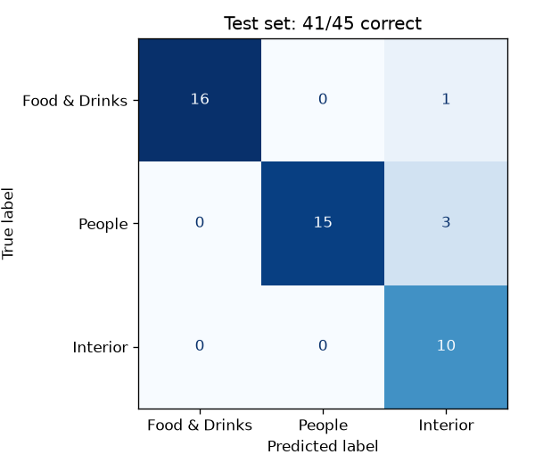
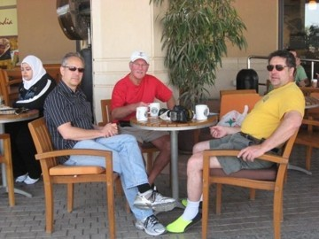

# Evaluation report

- Backbone: CLIP ViT-B/32 (frozen), classifier: logistic regression, C = 100.0
- Model selection: 5-fold stratified CV on train, accuracy 94.7% ± 3.4%
- **Test accuracy: 41 / 45 correct (91.1%)**

## Per-class metrics

| Class | Precision | Recall | F1 | Support |
|---|---|---|---|---|
| Food & Drinks | 1.000 | 0.941 | 0.970 | 17 |
| People | 1.000 | 0.833 | 0.909 | 18 |
| Interior | 0.714 | 1.000 | 0.833 | 10 |

## Confusion matrix

Rows are the true class, columns the predicted class.

| true \ predicted | Food & Drinks | People | Interior |
|---|---|---|---|
| Food & Drinks | 16 | 0 | 1 |
| People | 0 | 15 | 3 |
| Interior | 0 | 0 | 10 |

## Misclassified images

| File | True | Predicted | Probabilities |
|---|---|---|---|
| `data/test/people/381278a11557485ab28fb61aa27c1951.jpg` | people | interior | food_drinks 0.00, people 0.01, interior 0.99 |
| `data/test/people/02efbaea0f1c4e96b6ffbb1f6a19d919.jpg` | people | interior | food_drinks 0.00, people 0.02, interior 0.98 |
| `data/test/people/2fb066309ba54573a5d8f03d4738f692.jpg` | people | interior | food_drinks 0.01, people 0.01, interior 0.98 |
| `data/test/food_drinks/92c536eaccbb4084bdc3e20c52375b11.jpg` | food_drinks | interior | food_drinks 0.02, people 0.00, interior 0.98 |

## Lowest probability on the true class

| File | True | Predicted | Probabilities |
|---|---|---|---|
| `data/test/people/381278a11557485ab28fb61aa27c1951.jpg` | people | interior | food_drinks 0.00, people 0.01, interior 0.99 |
| `data/test/people/2fb066309ba54573a5d8f03d4738f692.jpg` | people | interior | food_drinks 0.01, people 0.01, interior 0.98 |
| `data/test/people/02efbaea0f1c4e96b6ffbb1f6a19d919.jpg` | people | interior | food_drinks 0.00, people 0.02, interior 0.98 |
| `data/test/food_drinks/92c536eaccbb4084bdc3e20c52375b11.jpg` | food_drinks | interior | food_drinks 0.02, people 0.00, interior 0.98 |
| `data/test/people/4eda754771ad4d60ba25939c7b1efa9f.jpg` | people | people | food_drinks 0.01, people 0.69, interior 0.30 |

## Most difficult example

`data/test/people/381278a11557485ab28fb61aa27c1951.jpg`: true **people**, predicted **interior** (food_drinks 0.00, people 0.01, interior 0.99)

