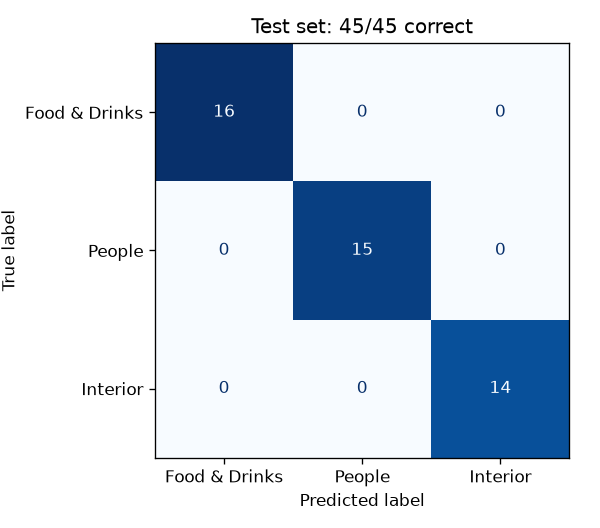

# Evaluation report

- Backbone: CLIP ViT-B/32 (frozen), classifier: logistic regression, C = 100.0
- Cross-validation on train (5-fold): 94.7% ± 3.4%
- **Test accuracy: 45 / 45 correct (100.0%)**

## Per-class metrics

| Class | Precision | Recall | F1 | Support |
|---|---|---|---|---|
| Food & Drinks | 1.000 | 1.000 | 1.000 | 16 |
| People | 1.000 | 1.000 | 1.000 | 15 |
| Interior | 1.000 | 1.000 | 1.000 | 14 |

## Confusion matrix

Rows are the true class, columns the predicted class.

| true \ predicted | Food & Drinks | People | Interior |
|---|---|---|---|
| Food & Drinks | 16 | 0 | 0 |
| People | 0 | 15 | 0 |
| Interior | 0 | 0 | 14 |

## Misclassified images

None.

## Lowest probability on the true class

| File | True | Predicted | Probabilities |
|---|---|---|---|
| `data/test/people/4eda754771ad4d60ba25939c7b1efa9f.jpg` | people | people | food_drinks 0.01, people 0.69, interior 0.30 |
| `data/test/food_drinks/ef69ad42af5f4eedb1a9387f6797d0d2.jpg` | food_drinks | food_drinks | food_drinks 0.77, people 0.01, interior 0.22 |
| `data/test/food_drinks/cceb51f7e99641cba8a0bd8a96195148.jpg` | food_drinks | food_drinks | food_drinks 0.87, people 0.04, interior 0.09 |
| `data/test/people/ef9b37c3b3084d9bba978a5e44aafbe9.jpg` | people | people | food_drinks 0.00, people 0.89, interior 0.11 |
| `data/test/people/173a92e50b39499cbc8b2ca9331f09e7.jpg` | people | people | food_drinks 0.02, people 0.90, interior 0.09 |

## Most difficult example

`data/test/people/4eda754771ad4d60ba25939c7b1efa9f.jpg`: true **people**, predicted **people** (food_drinks 0.01, people 0.69, interior 0.30)

