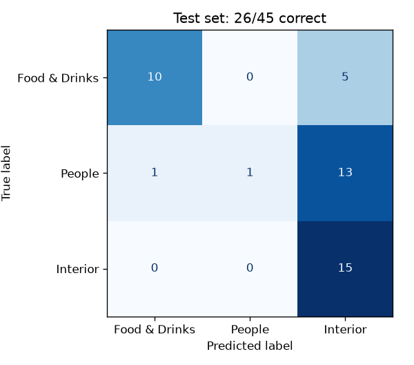
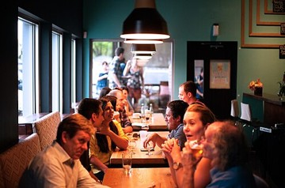

# Evaluation report

- Backbone: CLIP ViT-B/32 (frozen), classifier: logistic regression, C = 100.0
- Model selection: 5-fold stratified CV on train, accuracy 94.7% ± 3.4%
- **Test accuracy: 26 / 45 correct (57.8%)**

## Per-class metrics

| Class | Precision | Recall | F1 | Support |
|---|---|---|---|---|
| Food & Drinks | 0.909 | 0.667 | 0.769 | 15 |
| People | 1.000 | 0.067 | 0.125 | 15 |
| Interior | 0.455 | 1.000 | 0.625 | 15 |

## Confusion matrix

Rows are the true class, columns the predicted class.

| true \ predicted | Food & Drinks | People | Interior |
|---|---|---|---|
| Food & Drinks | 10 | 0 | 5 |
| People | 1 | 1 | 13 |
| Interior | 0 | 0 | 15 |

## Misclassified images

| File | True | Predicted | Probabilities |
|---|---|---|---|
| `data/holdout_cafe/people/2c52b0d0737403bda1772ff3.jpg` | people | interior | food_drinks 0.00, people 0.00, interior 1.00 |
| `data/holdout_cafe/people/9cda2d1ed150956b22f10dad.jpg` | people | interior | food_drinks 0.00, people 0.02, interior 0.98 |
| `data/holdout_cafe/people/c5727f6d6b61c40ae3494d43.jpg` | people | interior | food_drinks 0.01, people 0.01, interior 0.98 |
| `data/holdout_cafe/people/6e1a4dec5cde913e7c90459e.jpg` | people | interior | food_drinks 0.02, people 0.01, interior 0.97 |
| `data/holdout_cafe/food_drinks/d118c1a3090dfead522cb4d9.jpg` | food_drinks | interior | food_drinks 0.03, people 0.00, interior 0.97 |
| `data/holdout_cafe/people/9d23e751447a9e0f3600f8cd.jpg` | people | interior | food_drinks 0.02, people 0.01, interior 0.96 |
| `data/holdout_cafe/people/5a7eb9ee3376a3931c475bb5.jpg` | people | interior | food_drinks 0.02, people 0.07, interior 0.91 |
| `data/holdout_cafe/people/ee36617cf7be1e7e5c82ec2b.jpg` | people | interior | food_drinks 0.02, people 0.08, interior 0.89 |
| `data/holdout_cafe/people/bffb2c609f6e22b46c0d355c.jpg` | people | interior | food_drinks 0.00, people 0.13, interior 0.87 |
| `data/holdout_cafe/people/06b30b443d827263a7bd4697.jpg` | people | interior | food_drinks 0.00, people 0.16, interior 0.83 |
| `data/holdout_cafe/food_drinks/0048d4a44f5a47b23cdea92a.jpg` | food_drinks | interior | food_drinks 0.23, people 0.02, interior 0.74 |
| `data/holdout_cafe/food_drinks/536bbb1262ed779e3a02b3dc.jpg` | food_drinks | interior | food_drinks 0.26, people 0.01, interior 0.74 |
| `data/holdout_cafe/people/d91f70da619e3db70fabe1b2.jpg` | people | interior | food_drinks 0.01, people 0.29, interior 0.70 |
| `data/holdout_cafe/food_drinks/75ef9c216f4440c4d69f73db.jpg` | food_drinks | interior | food_drinks 0.33, people 0.01, interior 0.66 |
| `data/holdout_cafe/food_drinks/6fe5096fe9ad7cb69d478fd0.jpg` | food_drinks | interior | food_drinks 0.33, people 0.02, interior 0.64 |
| `data/holdout_cafe/people/a2d76a5a0f6e8b0647df309d.jpg` | people | interior | food_drinks 0.00, people 0.38, interior 0.61 |
| `data/holdout_cafe/people/de194aeca9d1917b18b6f44d.jpg` | people | interior | food_drinks 0.00, people 0.40, interior 0.60 |
| `data/holdout_cafe/people/ea1dc2964862a2928d764e83.jpg` | people | food_drinks | food_drinks 0.55, people 0.15, interior 0.30 |
| `data/holdout_cafe/people/45c0a117690e8188200ef5b4.jpg` | people | interior | food_drinks 0.00, people 0.46, interior 0.54 |

## Lowest probability on the true class

| File | True | Predicted | Probabilities |
|---|---|---|---|
| `data/holdout_cafe/people/2c52b0d0737403bda1772ff3.jpg` | people | interior | food_drinks 0.00, people 0.00, interior 1.00 |
| `data/holdout_cafe/people/c5727f6d6b61c40ae3494d43.jpg` | people | interior | food_drinks 0.01, people 0.01, interior 0.98 |
| `data/holdout_cafe/people/6e1a4dec5cde913e7c90459e.jpg` | people | interior | food_drinks 0.02, people 0.01, interior 0.97 |
| `data/holdout_cafe/people/9d23e751447a9e0f3600f8cd.jpg` | people | interior | food_drinks 0.02, people 0.01, interior 0.96 |
| `data/holdout_cafe/people/9cda2d1ed150956b22f10dad.jpg` | people | interior | food_drinks 0.00, people 0.02, interior 0.98 |

## Most difficult example

`data/holdout_cafe/people/2c52b0d0737403bda1772ff3.jpg`: true **people**, predicted **interior** (food_drinks 0.00, people 0.00, interior 1.00)

