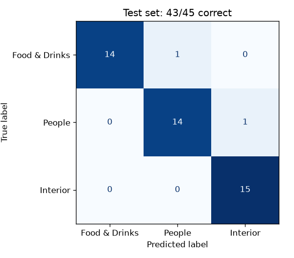

# Evaluation report

- Backbone: CLIP ViT-B/32 (frozen), classifier: logistic regression, C = 1.0, class_weight = balanced
- Model selection: 5-fold CV (grouped by venue/source, 233 groups) on train, balanced_accuracy 92.1% ± 3.1%
- **Test accuracy: 43 / 45 correct (95.6%)**

## Per-class metrics

| Class | Precision | Recall | F1 | Support |
|---|---|---|---|---|
| Food & Drinks | 1.000 | 0.933 | 0.966 | 15 |
| People | 0.933 | 0.933 | 0.933 | 15 |
| Interior | 0.938 | 1.000 | 0.968 | 15 |

## Confusion matrix

Rows are the true class, columns the predicted class.

| true \ predicted | Food & Drinks | People | Interior |
|---|---|---|---|
| Food & Drinks | 14 | 1 | 0 |
| People | 0 | 14 | 1 |
| Interior | 0 | 0 | 15 |

## Misclassified images

| File | True | Predicted | Probabilities |
|---|---|---|---|
| `data/holdout_cafe/people/2c52b0d0737403bda1772ff3.jpg` | people | interior | food_drinks 0.10, people 0.44, interior 0.46 |
| `data/holdout_cafe/food_drinks/d118c1a3090dfead522cb4d9.jpg` | food_drinks | people | food_drinks 0.38, people 0.39, interior 0.23 |

## Lowest probability on the true class

| File | True | Predicted | Probabilities |
|---|---|---|---|
| `data/holdout_cafe/food_drinks/d118c1a3090dfead522cb4d9.jpg` | food_drinks | people | food_drinks 0.38, people 0.39, interior 0.23 |
| `data/holdout_cafe/people/2c52b0d0737403bda1772ff3.jpg` | people | interior | food_drinks 0.10, people 0.44, interior 0.46 |
| `data/holdout_cafe/interior/c8e1002995504ff2db5793ab.jpg` | interior | interior | food_drinks 0.07, people 0.42, interior 0.51 |
| `data/holdout_cafe/food_drinks/0048d4a44f5a47b23cdea92a.jpg` | food_drinks | food_drinks | food_drinks 0.53, people 0.26, interior 0.21 |
| `data/holdout_cafe/interior/65ac4c1fd59272001a653363.jpg` | interior | interior | food_drinks 0.11, people 0.34, interior 0.55 |

## Most difficult example

`data/holdout_cafe/food_drinks/d118c1a3090dfead522cb4d9.jpg`: true **food_drinks**, predicted **people** (food_drinks 0.38, people 0.39, interior 0.23)

