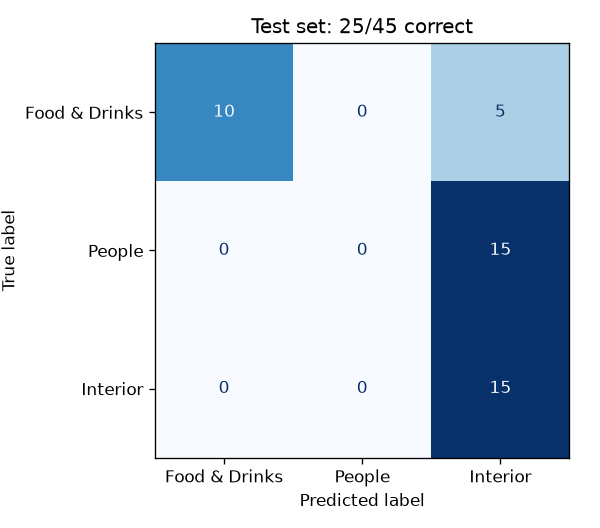
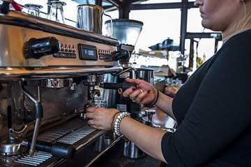

# Evaluation report

- Backbone: CLIP ViT-B/32 (frozen), classifier: logistic regression, C = 100.0
- Model selection: 5-fold stratified CV on train, accuracy 94.7% ± 3.4%
- **Test accuracy: 25 / 45 correct (55.6%)**

## Per-class metrics

| Class | Precision | Recall | F1 | Support |
|---|---|---|---|---|
| Food & Drinks | 1.000 | 0.667 | 0.800 | 15 |
| People | 0.000 | 0.000 | 0.000 | 15 |
| Interior | 0.429 | 1.000 | 0.600 | 15 |

## Confusion matrix

Rows are the true class, columns the predicted class.

| true \ predicted | Food & Drinks | People | Interior |
|---|---|---|---|
| Food & Drinks | 10 | 0 | 5 |
| People | 0 | 0 | 15 |
| Interior | 0 | 0 | 15 |

## Misclassified images

| File | True | Predicted | Probabilities |
|---|---|---|---|
| `data/holdout_fresh/people/4a3de2e3b678c22283a43dbe.jpg` | people | interior | food_drinks 0.00, people 0.00, interior 1.00 |
| `data/holdout_fresh/people/892fa8fabd4e8354d8251600.jpg` | people | interior | food_drinks 0.00, people 0.00, interior 1.00 |
| `data/holdout_fresh/people/d2a3ce9318c787b56f7bafc8.jpg` | people | interior | food_drinks 0.00, people 0.00, interior 0.99 |
| `data/holdout_fresh/people/107a137fc605167060a2b41e.jpg` | people | interior | food_drinks 0.00, people 0.00, interior 0.99 |
| `data/holdout_fresh/people/abcc35939f0067172dbb8cba.jpg` | people | interior | food_drinks 0.00, people 0.01, interior 0.99 |
| `data/holdout_fresh/people/24d21a4fec6e9a5fa8c76582.jpg` | people | interior | food_drinks 0.00, people 0.01, interior 0.99 |
| `data/holdout_fresh/people/f5fed7efbb8997b16a2ad98c.jpg` | people | interior | food_drinks 0.01, people 0.00, interior 0.99 |
| `data/holdout_fresh/people/a84a36edf776b555dd308b9e.jpg` | people | interior | food_drinks 0.01, people 0.01, interior 0.98 |
| `data/holdout_fresh/people/3912013bf333f5d5fd147923.jpg` | people | interior | food_drinks 0.01, people 0.01, interior 0.98 |
| `data/holdout_fresh/people/3492a9fd6f1b07369cebc0ee.jpg` | people | interior | food_drinks 0.01, people 0.01, interior 0.98 |
| `data/holdout_fresh/people/4ceb033b758811b84aee127c.jpg` | people | interior | food_drinks 0.02, people 0.05, interior 0.93 |
| `data/holdout_fresh/people/c6ada3e98ddd1269dcb1cc37.jpg` | people | interior | food_drinks 0.01, people 0.07, interior 0.92 |
| `data/holdout_fresh/people/95dc7f74dabe79982c4e1387.jpg` | people | interior | food_drinks 0.02, people 0.08, interior 0.90 |
| `data/holdout_fresh/people/04f929838b0af618a3f0c1bc.jpg` | people | interior | food_drinks 0.07, people 0.08, interior 0.85 |
| `data/holdout_fresh/food_drinks/bd701977a64e714e660e5c64.jpg` | food_drinks | interior | food_drinks 0.17, people 0.00, interior 0.82 |
| `data/holdout_fresh/food_drinks/ae88d0cf88cf8e6fcecc4ccf.jpg` | food_drinks | interior | food_drinks 0.05, people 0.16, interior 0.79 |
| `data/holdout_fresh/people/3ca030071b785a4446a06d37.jpg` | people | interior | food_drinks 0.22, people 0.04, interior 0.74 |
| `data/holdout_fresh/food_drinks/f14f8fc2ed8e69e7894a788b.jpg` | food_drinks | interior | food_drinks 0.30, people 0.01, interior 0.69 |
| `data/holdout_fresh/food_drinks/e455dd4b185cc8b031f212d0.jpg` | food_drinks | interior | food_drinks 0.38, people 0.00, interior 0.62 |
| `data/holdout_fresh/food_drinks/a920dd851684138ebe060b8c.jpg` | food_drinks | interior | food_drinks 0.38, people 0.01, interior 0.61 |

## Lowest probability on the true class

| File | True | Predicted | Probabilities |
|---|---|---|---|
| `data/holdout_fresh/people/892fa8fabd4e8354d8251600.jpg` | people | interior | food_drinks 0.00, people 0.00, interior 1.00 |
| `data/holdout_fresh/people/4a3de2e3b678c22283a43dbe.jpg` | people | interior | food_drinks 0.00, people 0.00, interior 1.00 |
| `data/holdout_fresh/people/f5fed7efbb8997b16a2ad98c.jpg` | people | interior | food_drinks 0.01, people 0.00, interior 0.99 |
| `data/holdout_fresh/people/d2a3ce9318c787b56f7bafc8.jpg` | people | interior | food_drinks 0.00, people 0.00, interior 0.99 |
| `data/holdout_fresh/people/107a137fc605167060a2b41e.jpg` | people | interior | food_drinks 0.00, people 0.00, interior 0.99 |

## Most difficult example

`data/holdout_fresh/people/892fa8fabd4e8354d8251600.jpg`: true **people**, predicted **interior** (food_drinks 0.00, people 0.00, interior 1.00)

