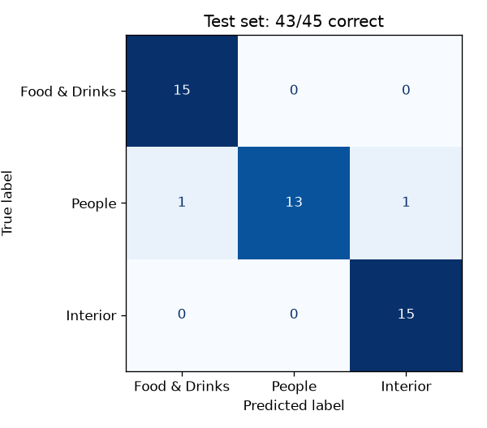
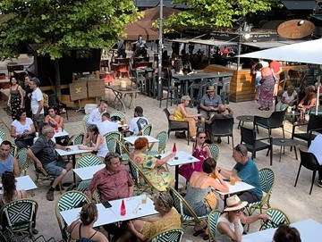

# Evaluation report

- Backbone: CLIP ViT-B/32 (frozen), classifier: logistic regression, C = 1.0, class_weight = balanced
- Model selection: 5-fold CV (grouped by venue/source, 233 groups) on train, balanced_accuracy 92.1% ± 3.1%
- **Test accuracy: 43 / 45 correct (95.6%)**

## Per-class metrics

| Class | Precision | Recall | F1 | Support |
|---|---|---|---|---|
| Food & Drinks | 0.938 | 1.000 | 0.968 | 15 |
| People | 1.000 | 0.867 | 0.929 | 15 |
| Interior | 0.938 | 1.000 | 0.968 | 15 |

## Confusion matrix

Rows are the true class, columns the predicted class.

| true \ predicted | Food & Drinks | People | Interior |
|---|---|---|---|
| Food & Drinks | 15 | 0 | 0 |
| People | 1 | 13 | 1 |
| Interior | 0 | 0 | 15 |

## Misclassified images

| File | True | Predicted | Probabilities |
|---|---|---|---|
| `data/holdout_fresh/people/4a3de2e3b678c22283a43dbe.jpg` | people | interior | food_drinks 0.07, people 0.27, interior 0.67 |
| `data/holdout_fresh/people/892fa8fabd4e8354d8251600.jpg` | people | food_drinks | food_drinks 0.41, people 0.37, interior 0.22 |

## Lowest probability on the true class

| File | True | Predicted | Probabilities |
|---|---|---|---|
| `data/holdout_fresh/people/4a3de2e3b678c22283a43dbe.jpg` | people | interior | food_drinks 0.07, people 0.27, interior 0.67 |
| `data/holdout_fresh/people/892fa8fabd4e8354d8251600.jpg` | people | food_drinks | food_drinks 0.41, people 0.37, interior 0.22 |
| `data/holdout_fresh/people/a84a36edf776b555dd308b9e.jpg` | people | people | food_drinks 0.15, people 0.46, interior 0.39 |
| `data/holdout_fresh/people/f5fed7efbb8997b16a2ad98c.jpg` | people | people | food_drinks 0.32, people 0.50, interior 0.19 |
| `data/holdout_fresh/people/107a137fc605167060a2b41e.jpg` | people | people | food_drinks 0.14, people 0.51, interior 0.34 |

## Most difficult example

`data/holdout_fresh/people/4a3de2e3b678c22283a43dbe.jpg`: true **people**, predicted **interior** (food_drinks 0.07, people 0.27, interior 0.67)

